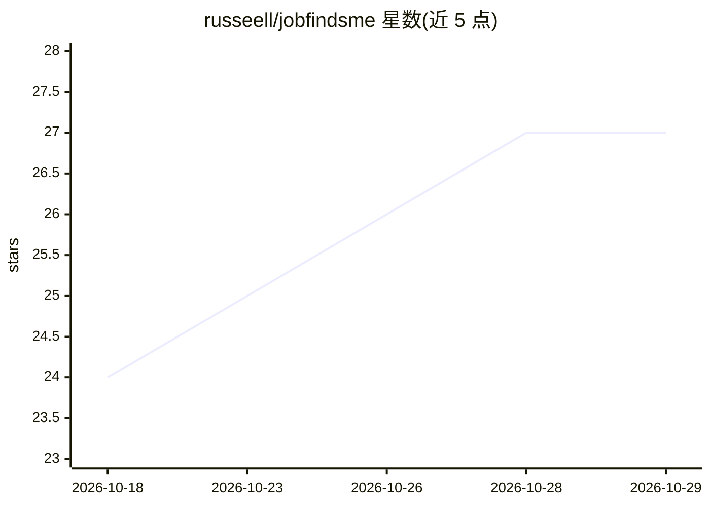

# russeell/jobfindsme

⭐ 27 · Python · MIT · 推送 2026-10-15 · [GitHub](https://github.com/russeell/jobfindsme) · [官网](https://github.com/russeell/jobfindsme/releases/latest) · 个人维护 · 中文 README

**面向中文求职者的本地优先 AI 求职桌面助手**

跨平台（macOS M 系列 / Windows x64）开源桌面应用，把四个招聘平台（BOSS直聘、猎聘、智联招聘、前程无忧）的岗位检索、简历编辑、模拟面试、公司背调与投递管理整合在一个工作台，内嵌浏览器核对原页。简历、会话与记录保存在本机；AI 功能（简历修改、面试练习、招呼语润色）需用户自行连接模型服务方可使用，基础求职流程不依赖 AI。安装包未签名，提供应用内更新与失败回滚。

## 筛选速览

| 维度 | 判定 | 备注 |
|---|---|---|
| AI 角色 | `ai-enhanced` | 去掉 AI 部分产品仍成立 |
| 许可风险 | `permissive` | MIT |
| 部署形态 | `desktop` | 安装包/桌面程序 |
| 模型依赖 | — | README 未给出锁定关系 |
| 硬件要求 | — | 无带数字的原话,不猜 |
| 安装摩擦 | `low` | 无编译、无系统依赖或容器化 |
| 成熟度 | — | 结构信号不足 |

## 能力要点

- 一次检索 BOSS直聘/猎聘/智联/前程无忧四个平台并统一筛选
- PDF/DOCX 简历导入、编辑副本、对照 JD 的 AI 修改与逐项审阅
- AI 修改中拦截数字、日期及部分明确事实变化
- 本地数据保存，AI 仅在用户连接自有模型服务时启用

## 适用场景

- 在多个招聘平台统一搜索并筛选岗位
- 对照岗位 JD 修改简历并保存岗位专属版本
- 围绕具体岗位练习面试、做公司背调
- 记录投递历史并安排后续跟进事项

## 场景标签

`AI 助手` · 领域:对话与助手

## 证据(README 行号)

> L4:  跨平台找岗位，把简历、面试和投递串起来。 开源 AI 求职桌面助手 · macOS / Windows · 数据保存在本机
> L14: **不用上传简历、配置模型，也能先找工作。** 需要 AI 修改、面试或背调时，再连接你自己的模型服务。
> L94: 3. **再用 AI 准备**：在设置中连接自己的模型；简历修改在「我的简历」，面试和背调从岗位或「求职助手」开始。

## 星数曲线

2026-10-18 24 → 2026-10-29 27（+3）

---
*卡片 v1 · prompt 1.4 · 生成 2026-10-26 · 置信度 high · 依据 README sha `f3173af2d571` · [字段定义](../../DATASET.md)*
