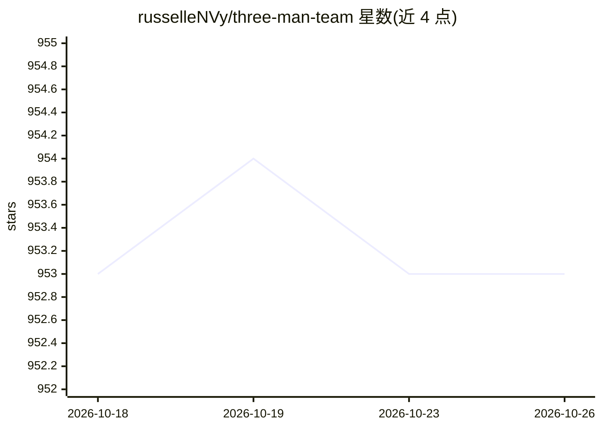

# russelleNVy/three-man-team

⭐ 953 · Shell · MIT · 推送 2026-06-09 · [GitHub](https://github.com/russelleNVy/three-man-team) · 个人维护

**给 AI 编码工具的 3 agent 结构化开发团队模板**

由 Architect、Builder、Reviewer 三个角色组成的 agent 工作流模板，以 markdown 上下文文件形式安装到 Claude Code（单个会话内以 subagent 方式轮转，Agent 规划部署、Builder 按简报实现、Reviewer 审查）。提供 per-project 与全局两种 git clone 安装方式，附 setup 脚本、token 优化五规则、自动更新（读 releases/latest.json）与两套 persona 模板。也声明可用于任何支持上下文文件的 AI 工具。另有 'Three Man Team Pro' 付费等待列表，MIT 许可。

## 筛选速览

| 维度 | 判定 | 备注 |
|---|---|---|
| AI 角色 | `ai-ecosystem` | LLM/agent 周边工具 |
| 许可风险 | `permissive` | MIT |
| 部署形态 | `None` |  |
| 模型依赖 | — | README 未给出锁定关系 |
| 硬件要求 | — | 无带数字的原话,不猜 |
| 安装摩擦 | `low` | 无编译、无系统依赖或容器化 |
| 成熟度 | — | 结构信号不足 |

## 能力要点

- 三角色分工：Architect 规划部署、Builder 按简报构建、Reviewer 审查
- 在单个 Claude Code 会话内通过 Agent tool 以 subagent 方式运转
- 每次安装附带 token-optimizer 技能，经 CLAUDE.md 自动加载
- setup 脚本 + manifest.md 单一事实源 + 版本注册表自动更新

## 适用场景

- 让 Claude Code 按 计划→构建→审查 流程完成开发任务
- 减少 AI 编码过程中的 token 消耗与任务漂移
- 全局安装后在多个项目中复用同一套 agent 角色

## 场景标签

`编码 Agent` `多智能体` · 领域:Agent 开发

## 证据(README 行号)

> L30: Three Man Team gives you three agents with distinct jobs, clear handoffs, and rules that prevent the most expensive
> L46: **How the team runs:** Three Man Team uses one Claude Code session. Arch is your main agent. When work is ready to 
> L57: git clone https://github.com/russelleNVy/three-man-team.git .claude/skills/three-man-team

## 星数曲线

2026-10-18 953 → 2026-10-26 953（+0）

---
*卡片 v1 · prompt 1.4 · 生成 2026-10-21 · 置信度 high · 依据 README sha `25e0d32b6d9a` · [字段定义](../../DATASET.md)*
