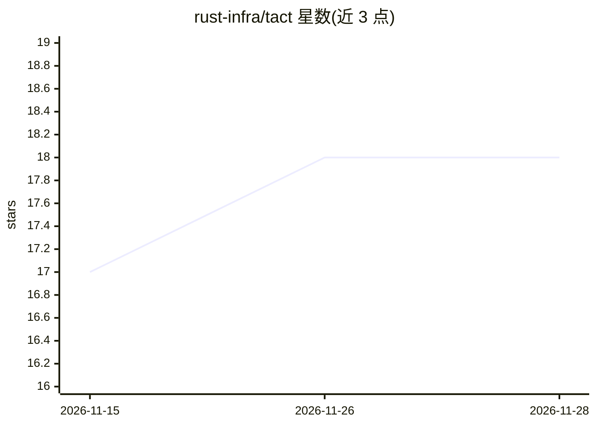

# rust-infra/tact

⭐ 18 · Rust · MIT · 推送 2026-11-27 · [GitHub](https://github.com/rust-infra/tact) · [官网](https://github.com/rust-infra/tact#readme) · 个人维护 · 中文 README

**Rust 编写的终端与桌面 AI 编程 agent，自托管无账号**

tact 是用 Rust 实现的 AI coding agent，提供终端 TUI（tact-ui）与 GPUI 原生桌面应用（tact-desktop）两种前端。它读取代码库、编辑文件、运行命令、搜索代码并协调子 agent；采用多轮 agent 循环、分层上下文压缩（auto-compact / micro-compact）、持久化会话与本地 SQLite 存储按调用记录 token 用量。支持 MCP 插件、自定义技能、命令 hooks 与工具宏，可通过 ACP 适配器被外部客户端调用。自托管运行时，无托管服务、无账号、无遥测，MIT 许可。安装经 shell/PowerShell 脚本或从源码构建（需 Rust 1.99+，Linux 需 SQLite 构建依赖）。

## 筛选速览

| 维度 | 判定 | 备注 |
|---|---|---|
| AI 角色 | `ai-native` | 本体是模型或模型工具 |
| 许可风险 | `permissive` | MIT |
| 部署形态 | `library` | 以包/库形式分发 |
| 模型依赖 | locked-api |  |
| 硬件要求 | — | 无带数字的原话,不猜 |
| 安装摩擦 | `medium` | 含编译或系统依赖之一 |
| 成熟度 | — | 结构信号不足 |

## 能力要点

- 终端 TUI 与原生 GPUI 桌面应用共享同一会话运行时
- 分层上下文压缩（80% auto-compact + micro-compact）与上下文窗口用量计
- MCP 插件/市场、技能（SKILL.md）、命令 hooks 与子 agent 支持
- 按调用持久化 token 用量、缓存命中与推理 token 到本地 SQLite

## 适用场景

- 在终端里让 AI agent 修改代码、运行命令并管理任务
- 通过桌面应用或 ACP 客户端驱动同一 agent 会话
- 在不依赖托管服务的前提下自托管 AI 编程 agent

## 场景标签

`编码 Agent` · 领域:编码与开发

## 证据(README 行号)

> L22: tact is an **AI coding agent with a terminal UI and a native desktop app**. It
> L23: reads your codebase, understands your intent, and executes. It edits files,

## 星数曲线

2026-11-15 17 → 2026-11-28 18（+1）

---
*卡片 v1 · prompt 1.4 · 生成 2026-11-18 · 置信度 high · 依据 README sha `aa912df46199` · [字段定义](../../DATASET.md)*
