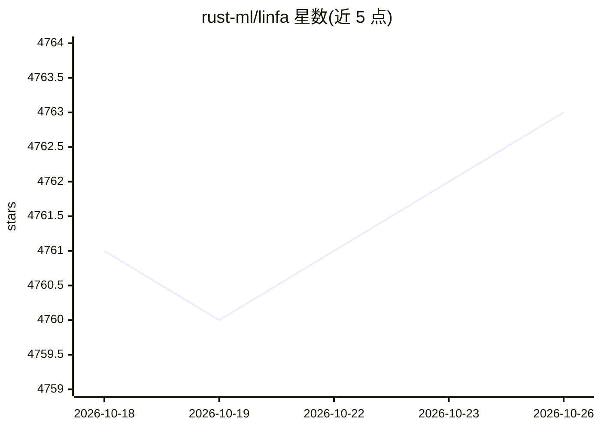

# rust-ml/linfa

⭐ 4,763 · Rust · Apache-2.0 · 推送 2026-08-22 · [GitHub](https://github.com/rust-ml/linfa) · 组织维护

**Rust 机器学习工具包：经典 ML 算法与预处理库**

用 Rust 构建机器学习应用的工具包，定位类似 Python 的 scikit-learn。以子包形式提供约 20 类经典算法：监督学习（Naive Bayes、随机森林、SVM、线性/逻辑回归等）、无监督学习（K-Means、DBSCAN、t-SNE 等）、预处理（归一化、tf-idf、PCA 等）。线性代数默认用纯 Rust 实现，可通过 feature 切换 OpenBLAS/Netlib/Intel MKL 后端；支持 wasm32-unknown-unknown 浏览器 WASM。以 crates.io 上的 Cargo 包发布。

## 筛选速览

| 维度 | 判定 | 备注 |
|---|---|---|
| AI 角色 | `ai-native` | 本体是模型或模型工具 |
| 许可风险 | `permissive` | Apache-2.0 |
| 部署形态 | `library` | 以包/库形式分发 |
| 模型依赖 | — | README 未给出锁定关系 |
| 硬件要求 | — | 无带数字的原话,不猜 |
| 安装摩擦 | `low` | 无编译、无系统依赖或容器化 |
| 成熟度 | — | 结构信号不足 |

## 能力要点

- 约 20 个子包覆盖监督/无监督学习与预处理算法
- BLAS/LAPACK 后端可选（OpenBLAS/Netlib/Intel MKL），默认纯 Rust 实现
- 支持浏览器 WASM（wasm-bindgen feature）
- 部分算法支持 partial fit 增量更新（ftrl、logistic）

## 适用场景

- 在 Rust 项目中使用经典机器学习算法建模
- 对无标签数据做聚类与降维分析
- 文本特征化（count vectorization/tf-idf）与数据预处理

## 场景标签

 · 领域:机器学习/科学计算

## 证据(README 行号)

> L15: `linfa` aims to provide a comprehensive toolkit to build Machine Learning applications with Rust.
> L17: Kin in spirit to Python's `scikit-learn`, it focuses on common preprocessing tasks and classical ML algorithms for 

## 星数曲线

2026-10-18 4,761 → 2026-10-26 4,763（+2）

---
*卡片 v1 · prompt 1.4 · 生成 2026-10-20 · 置信度 high · 依据 README sha `775d27ab5939` · [字段定义](../../DATASET.md)*
