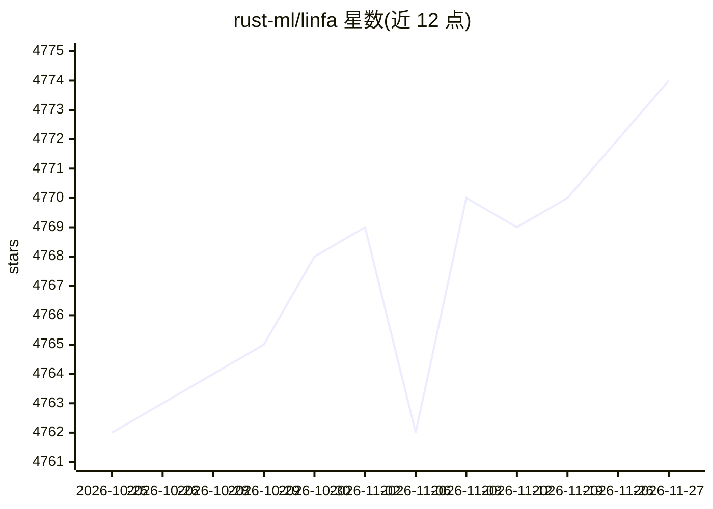

# rust-ml/linfa

⭐ 4,774 · Rust · Apache-2.0 · 推送 2026-11-23 · [GitHub](https://github.com/rust-ml/linfa) · 组织维护

**Rust 机器学习工具箱：提供经典 ML 算法与预处理**

linfa 是以 Rust 编写的机器学习框架，目标是为构建 ML 应用提供综合工具集，定位类似 Python 的 scikit-learn，聚焦常规预处理任务与经典机器学习算法。以子 crate 形式组织约 18 个算法包，涵盖朴素贝叶斯、聚类、集成方法、SVM、决策树、线性/逻辑回归、降维与预处理等，各包标注 Tested/Tested-Benchmarked 状态。支持 WASM 目标（wasm32-unknown-unknown），可选外部 BLAS/LAPACK 后端（OpenBLAS/Netlib/Intel MKL），默认使用纯 Rust 线性代数实现。

## 筛选速览

| 维度 | 判定 | 备注 |
|---|---|---|
| AI 角色 | `ai-native` | 本体是模型或模型工具 |
| 许可风险 | `permissive` | Apache-2.0 |
| 部署形态 | `library` | 以包/库形式分发 |
| 模型依赖 | — | README 未给出锁定关系 |
| 硬件要求 | — | 无带数字的原话,不猜 |
| 安装摩擦 | `low` | 无编译、无系统依赖或容器化 |
| 成熟度 | — | 结构信号不足 |

## 能力要点

- 约 18 个算法子包，覆盖监督/无监督学习与预处理
- 支持 wasm32-unknown-unknown 的浏览器 WASM 编译
- 可选 OpenBLAS/Netlib/Intel MKL 线性代数后端，默认纯 Rust 实现

## 适用场景

- 在 Rust 项目中做分类、回归、聚类等经典机器学习任务
- 数据预处理：归一化、whitening、tf-idf 向量化
- 在浏览器 WASM 环境中运行机器学习推理

## 场景标签

 · 领域:机器学习框架/科学计算

## 证据(README 行号)

> L15: `linfa` aims to provide a comprehensive toolkit to build Machine Learning applications with Rust.
> L17: Kin in spirit to Python's `scikit-learn`, it focuses on common preprocessing tasks and classical ML algorithms for 

## 星数曲线

2026-10-25 4,762 → 2026-11-27 4,774（+12）

---
*卡片 v1 · prompt 1.4 · 生成 2026-11-24 · 置信度 high · 依据 README sha `158c6b6cdfe7` · [字段定义](../../DATASET.md)*
