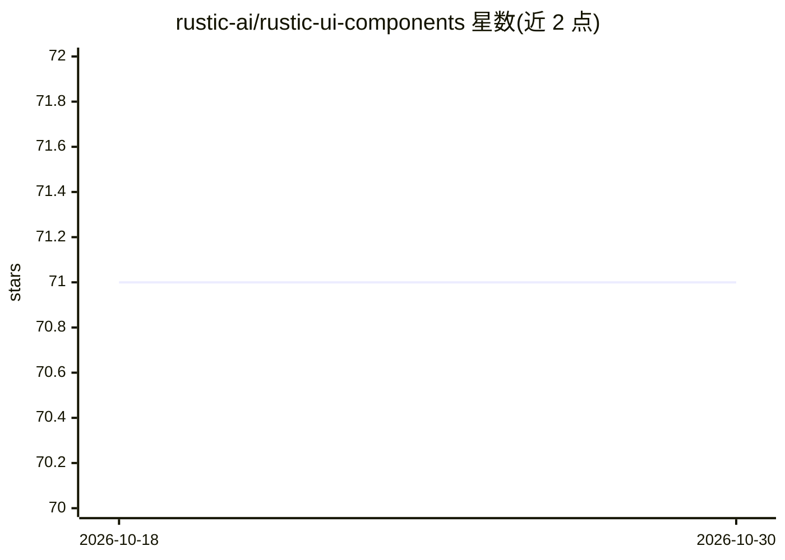

# rustic-ai/rustic-ui-components

⭐ 71 · JavaScript · MIT · 推送 2026-09-13 · [GitHub](https://github.com/rustic-ai/rustic-ui-components) · [官网](https://rustic-ai.github.io/rustic-ui-components/) · 组织维护

**构建多模态对话界面的 React 组件库**

Rustic AI 的 UI 组件库：提供一组可复用的 React 组件，用于构建交互式多模态聊天界面，面向开发聊天机器人、虚拟助手或通讯平台的开发者。组件库基于 MUI（标签中列出），配套 Storybook 文档、主题与样式指南，另有 Figma 设计文件可供查看。安装与使用方式指引至 Storybook 的 Quick Start 页面，从源码构建需参考 CONTRIBUTING.md。项目采用 MIT 许可证。

## 筛选速览

| 维度 | 判定 | 备注 |
|---|---|---|
| AI 角色 | `ai-ecosystem` | LLM/agent 周边工具 |
| 许可风险 | `permissive` | MIT |
| 部署形态 | `None` |  |
| 模型依赖 | — | README 未给出锁定关系 |
| 硬件要求 | — | 无带数字的原话,不猜 |
| 安装摩擦 | `low` | 无编译、无系统依赖或容器化 |
| 成熟度 | — | 结构信号不足 |

## 能力要点

- 面向多模odal聊天界面的可复用 React 组件集合
- 提供 Storybook 文档与主题/样式指南
- 提供 Figma 设计文件
- MIT 许可证

## 适用场景

- 开发聊天机器人或虚拟助手的前端界面
- 构建多模态通讯平台的对话组件

## 场景标签

 · 领域:前端/对话式 AI UI

## 证据(README 行号)

> L1: # UI Components for Rustic AI
> L3: The UI Components for Rustic AI is a comprehensive collection of reusable components designed specifically to empowe

## 星数曲线

2026-10-18 71 → 2026-10-30 71（+0）

---
*卡片 v1 · prompt 1.4 · 生成 2026-10-24 · 置信度 mid · 依据 README sha `5d1fef65afd4` · [字段定义](../../DATASET.md)*
