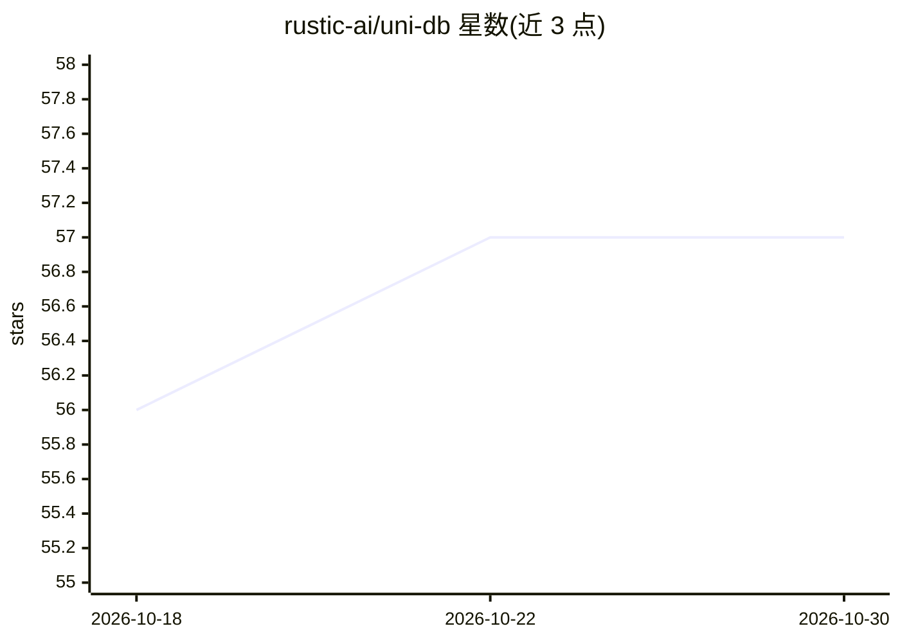

# rustic-ai/uni-db

⭐ 57 · Rust · Apache-2.0 · 推送 2026-10-28 · [GitHub](https://github.com/rustic-ai/uni-db) · [官网](https://rustic-ai.github.io/uni-db/) · 组织维护

**嵌入式图+向量+列存一体化数据库，面向本地多模态数据访问**

Uni 是一个嵌入式数据库，将属性图（OpenCypher 查询）、向量检索（K-NN、L2/cosine、BM25 混合）与 Lance 列式存储合并到单一引擎中，以库形式嵌入应用运行，无需独立服务进程。提供快照隔离的可序列化事务、Datalog 风格递归规则、PageRank/Louvain 等图算法以及命名 Forks 分支机制。持久化支持本地磁盘与对象存储（S3/GCS）。以 Rust crate 与 Python 绑定（PyO3）形式提供，另有 pydantic OGM 包。属 Rustic Initiative，由 Dragonspace Industries Inc. 维护，Apache 2.0 许可。

## 筛选速览

| 维度 | 判定 | 备注 |
|---|---|---|
| AI 角色 | `ai-ecosystem` | LLM/agent 周边工具 |
| 许可风险 | `permissive` | Apache-2.0 |
| 部署形态 | `library` | 以包/库形式分发 |
| 模型依赖 | — | README 未给出锁定关系 |
| 硬件要求 | — | 无带数字的原话,不猜 |
| 安装摩擦 | `low` | 无编译、无系统依赖或容器化 |
| 成熟度 | — | 结构信号不足 |

## 能力要点

- 属性图（OpenCypher）+ 向量检索 + Lance 列存单引擎
- 快照隔离可序列化事务，冲突提交可重试
- Datalog 风格递归规则，支持概率语义与神经谓词
- Rust crate 与 Python (PyO3) 双语言绑定

## 适用场景

- 在应用内本地嵌入图与向量混合查询，无需独立数据库服务
- 为 RAG/知识管理应用提供图谱+向量一体化存储
- 需要对象存储（S3/GCS）持久化的本地多模态数据访问

## 场景标签

`向量数据库` · 领域:知识与检索

## 证据(README 行号)

> L7: **Uni** is an embedded database that combines a property graph (OpenCypher), vector search, and columnar storage (La
> L17: - **Vector Search:** K-NN similarity search (L2, cosine) with pre-filter and threshold support, plus hybrid vector 

## 星数曲线

2026-10-18 56 → 2026-10-30 57（+1）

---
*卡片 v1 · prompt 1.4 · 生成 2026-10-24 · 置信度 high · 依据 README sha `df5dd93a3848` · [字段定义](../../DATASET.md)*
