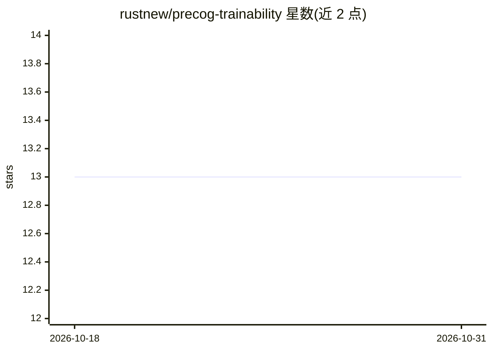

# rustnew/precog-trainability

⭐ 13 · Python · MIT · 推送 2026-09-04 · [GitHub](https://github.com/rustnew/precog-trainability) · 组织维护

**研究原型：用零成本信号预测超参数可训练性**

PyTorch 研究原型，检验未训练网络上的 11 种零成本代理信号（SynFlow、SNIP、NASWOT 等）能否预测哪些超参数/初始化方案训练效果好。在 60 个锁定测试任务上比较 RandomForest、GP、k-NN 及多种代理组合，最优为直接用 jacob_cov 排序（47% top-1）。README 同时记录修正过的小样本高估结论（ρ=0.670→0.395）、jacob_cov 对 He/Xavier 初始化尺度不变的数学盲区等未解问题，以及 12/12 任务的负结果。附 2.5MB 元数据集可免训练复现。作者声明非完成系统，全部成功门槛未达标。

## 筛选速览

| 维度 | 判定 | 备注 |
|---|---|---|
| AI 角色 | `ai-native` | 本体是模型或模型工具 |
| 许可风险 | `permissive` | MIT |
| 部署形态 | `library` | 以包/库形式分发 |
| 模型依赖 | — | README 未给出锁定关系 |
| 硬件要求 | — | 无带数字的原话,不猜 |
| 安装摩擦 | `low` | 无编译、无系统依赖或容器化 |
| 成熟度 | `idea` | |

## 能力要点

- 实现 11 种零成本可训练性代理（SynFlow/SNIP/NASWOT/ZiCo 等）
- 附 312 任务/936 实验的元数据集，可零训练复现结果
- 公开记录小样本高估修正与 jacob_cov 的尺度不变盲区及两次失败修复尝试
- 同时报告 top-1 准确率与决策代价（regret）两类指标

## 适用场景

- NAS/零成本代理/元学习研究者复现与审查该研究结论
- 在训练前用单次前向/反向传播筛选初始化或超参数候选
- 作为小样本相关性结论复核方法（扩大样本重检）的参照案例

## 场景标签

`科研工具` · 领域:学习与行业

## 证据(README 行号)

> L7: A research prototype testing whether "zero-cost" signals computed on an
> L46: `precog/trainability.py` implements 11 zero-cost proxies (SynFlow,
> L175: python scripts/gate1_ranking.py              # the original (overestimated) result

## 星数曲线

2026-10-18 13 → 2026-10-31 13（+0）

---
*卡片 v1 · prompt 1.4 · 生成 2026-10-31 · 置信度 mid · 依据 README sha `30ac37c08461` · [字段定义](../../DATASET.md)*
