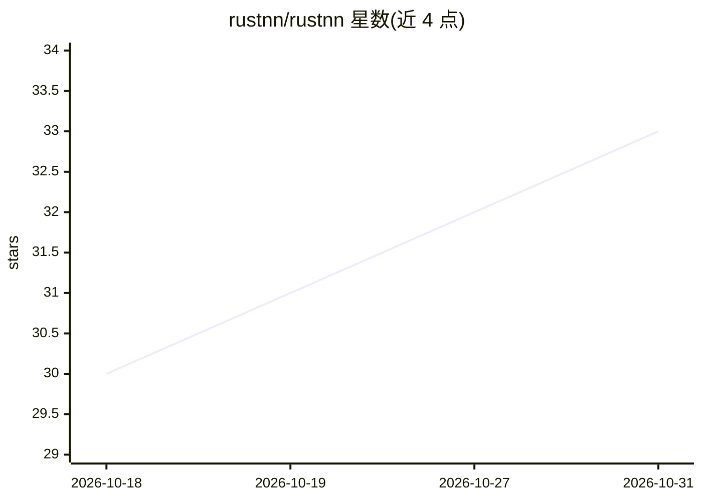

# rustnn/rustnn

⭐ 33 · Rust · Apache-2.0 · 推送 2026-10-30 · [GitHub](https://github.com/rustnn/rustnn) · [官网](https://rustnn.github.io/rustnn/) · 组织维护

**W3C WebNN API 的 Rust 实现，带可插拔执行后端**

以 Rust 实现 W3C WebNN 规范的神经网络 API：MLContext/MLGraphBuilder 等接口镜像 JavaScript 版 WebNN，后端在创建上下文时选择，支持 ONNX Runtime、NVIDIA TensorRT-RTX、Apple CoreML、LiteRT、Huawei CANN 与 Burn CPU。支持加载 .webnn 图、导出 ONNX/CoreML/TFLite 等格式，并在每次 PR 中运行上游 Web Platform Tests 做一致性测试。面向 Rust/C/C++ 开发者，经 crates.io 分发，Python 用户通过单独的 pywebnn 包使用。自述为 0.6.0 实验性开发版，API 无兼容性承诺。

## 筛选速览

| 维度 | 判定 | 备注 |
|---|---|---|
| AI 角色 | `ai-ecosystem` | LLM/agent 周边工具 |
| 许可风险 | `permissive` | Apache-2.0 |
| 部署形态 | `library` | 以包/库形式分发 |
| 模型依赖 | — | README 未给出锁定关系 |
| 硬件要求 | — | 无带数字的原话,不猜 |
| 安装摩擦 | `high` | 编译与系统依赖俱全 |
| 成熟度 | `idea` | |

## 能力要点

- 镜像 W3C WebNN JavaScript API 的 Rust 接口（MLContext/MLGraphBuilder 等）
- 六种可选执行后端：ONNX Runtime、TensorRT-RTX、CoreML、LiteRT、CANN、Burn CPU
- 图互转：加载 .webnn 图、导出 ONNX/CoreML/TFLite/TensorRT/CANN 模型
- 通过 capi 特性提供 C11 头文件、C++17 RAII 包装与 CMake/pkg-config 包信息

## 适用场景

- 在 Rust/C/C++ 项目中按 WebNN API 构建与执行神经网络图
- 把 WebNN 图转换为 ONNX/CoreML/TFLite 等格式做跨后端部署
- 验证后端对 WebNN 规范的一致性（WPT 测试）

## 场景标签

`推理引擎` · 领域:训练与推理

## 证据(README 行号)

> L7:  A Rust implementation of the W3C WebNN API with pluggable execution backends.
> L19: - **Backends selected at context creation.** ONNX Runtime, NVIDIA TensorRT-RTX, Apple CoreML,

## 星数曲线

2026-10-18 30 → 2026-10-31 33（+3）

---
*卡片 v1 · prompt 1.4 · 生成 2026-10-26 · 置信度 high · 依据 README sha `6d6c554286d1` · [字段定义](../../DATASET.md)*
