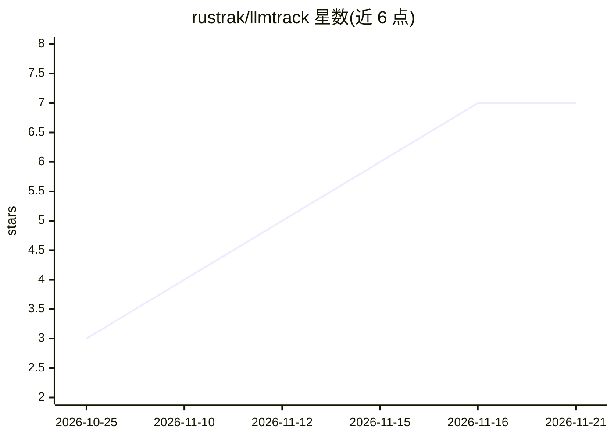

# rustrak/llmtrack

⭐ 7 · Rust · GPL-3.0 · 推送 2026-11-20 · [GitHub](https://github.com/rustrak/llmtrack) · 个人维护

**自托管 LLM 网关：统一 API、虚拟密钥与团队用量计费**

用 Rust 编写的自托管 LLM 网关：将任一 OpenAI SDK 指向它，即可为每个团队/个人发放可限额、可吊销的虚拟密钥，并在内置仪表板中查看各团队的花费。支持 OpenAI 与 Anthropic 两种 API 方言，后端覆盖 OpenAI、Azure、Gemini、Groq、Mistral、DeepSeek、OpenRouter、Together、Ollama 及任何 OpenAI 兼容服务器；默认 SQLite 单容器部署，密钥加密存储，路由支持加权多部署、失败冷却与回退。提供 LiteLLM 兼容层（读 x-litellm-* 头、共用其价格表）及请求日志（默认不存 prompt/completion）。

## 筛选速览

| 维度 | 判定 | 备注 |
|---|---|---|
| AI 角色 | `ai-ecosystem` | LLM/agent 周边工具 |
| 许可风险 | `viral` | GPL-3.0 |
| 部署形态 | `self-host` | docker 或自建部署 |
| 模型依赖 | local-ok | 支持本地模型 |
| 硬件要求 | — | 无带数字的原话,不猜 |
| 安装摩擦 | `low` | 无编译、无系统依赖或容器化 |
| 成熟度 | — | 结构信号不足 |

## 能力要点

- 虚拟密钥：可设预算、速率限制、模型白名单、过期与吊销
- 实时计费：缓存读写、reasoning tokens、长上下文分层分开计价，金额整数化
- 路由器：多部署加权、失败重试冷却、模型回退（含上下文超限回退）
- LiteLLM 兼容：客户端无需改动，价格表每日同步

## 适用场景

- 多个团队共用 LLM 时统一管理密钥并按团队核算花费
- 给下游应用发受限虚拟密钥，避免泄露 provider 原始 key
- 从 LiteLLM proxy 迁移而客户端代码不变
- 记录每次请求的 token、成本与延迟用于观测

## 场景标签

`模型网关` `LLM 可观测性` · 领域:Agent 开发

## 证据(README 行号)

> L14: llmtrack is a self-hosted LLM gateway. Point any OpenAI SDK at it, hand each
> L17: It speaks OpenAI's and Anthropic's APIs and sits in front of OpenAI, Azure,
> L83: Clients written for LiteLLM's proxy work unchanged. llmtrack reads the

## 星数曲线

2026-10-25 3 → 2026-11-21 7（+4）

---
*卡片 v1 · prompt 1.4 · 生成 2026-11-20 · 置信度 mid · 依据 README sha `25f94ea7bfcd` · [字段定义](../../DATASET.md)*
