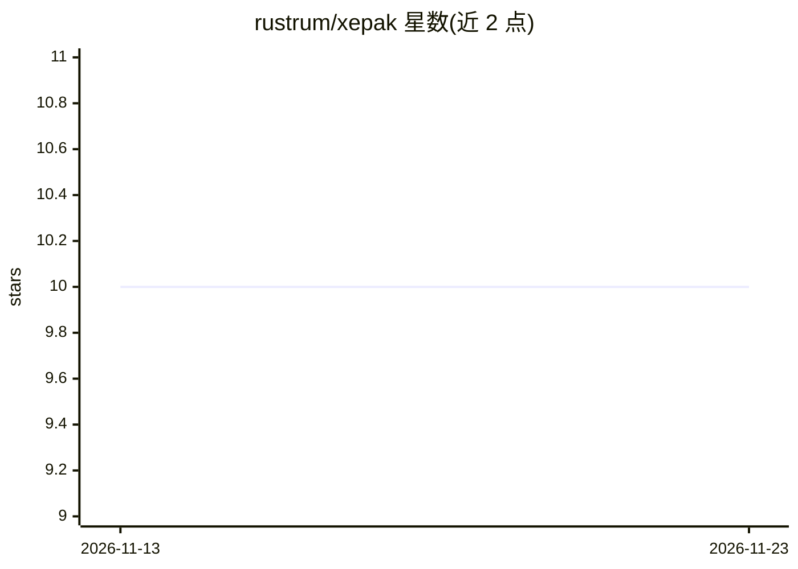

# rustrum/xepak

⭐ 10 · Rust · MIT · 推送 2026-11-17 · [GitHub](https://github.com/rustrum/xepak) · 个人维护

**基于 DSL 的 SQLite 数据库 REST/RPC/MCP 服务生成器**

用 TOML DSL 配置即可将 SQL 数据库（当前支持 SQLite，其他数据库规划中）暴露为 REST、JSON-RPC 或 MCP 服务，标准 CRUD 无需编写后端代码。支持 Lua 脚本处理限速、输入校验、访问控制等逻辑，内置基于 API key 与角色表达式的认证授权模块，输入输出支持 JSON 与 CBOR 格式。面向快速原型、自托管服务、边缘/IoT 设备与本地 RAG 场景。README 声明遵循 zer0ver 版本化，无 1.x 版本计划。

## 筛选速览

| 维度 | 判定 | 备注 |
|---|---|---|
| AI 角色 | `ai-enhanced` | 去掉 AI 部分产品仍成立 |
| 许可风险 | `permissive` | MIT |
| 部署形态 | `self-host` | docker 或自建部署 |
| 模型依赖 | — | README 未给出锁定关系 |
| 硬件要求 | — | 无带数字的原话,不猜 |
| 安装摩擦 | `low` | 无编译、无系统依赖或容器化 |
| 成熟度 | — | 结构信号不足 |

## 能力要点

- TOML DSL 声明式配置 REST/JSON-RPC/MCP 三类服务
- Lua 脚本扩展：限速、输入校验、访问控制、JSON/CBOR 输出
- 内置认证模块：API key、角色/ID 授权表达式、Lua 预处理器
- 安装途径覆盖 cargo、Docker、AUR、Homebrew

## 适用场景

- 不写后端代码快速搭建有状态的 REST API 原型
- 在树莓派等嵌入式设备上部署轻量 API 服务
- 为本地优先的桌面应用提供同步层或 API
- 为 AI agent 搭建数据留在本地的 RAG/MCP 服务

## 场景标签

`RAG` · 领域:知识与检索

## 证据(README 行号)

> L16: Xepak is a DSL configurable REST,JSON-RPC,MCP service that runs against SQL DB. Support SQLite for now with other D
> L37: - 🤖 **local RAG for AI/LLM sandboxes:** keeping AI agent knowledge local to prioritize data privacy and ownership
> L74: - MCP service

## 星数曲线

2026-11-13 10 → 2026-11-23 10（+0）

---
*卡片 v1 · prompt 1.4 · 生成 2026-11-19 · 置信度 high · 依据 README sha `043f0a6e0a33` · [字段定义](../../DATASET.md)*
