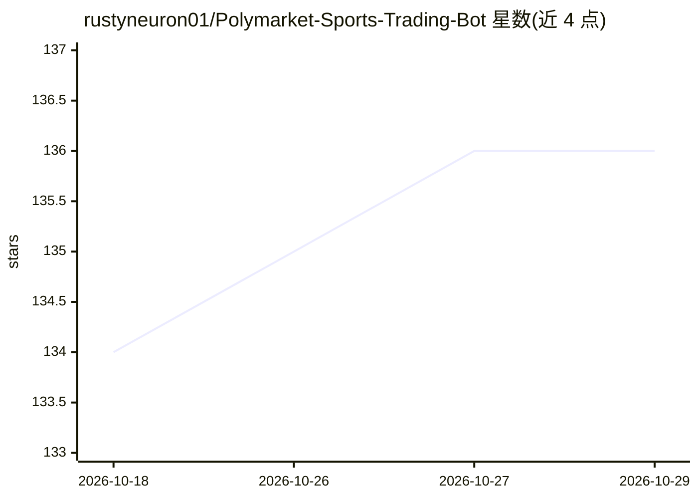

# rustyneuron01/Polymarket-Sports-Trading-Bot

⭐ 136 · Python · 推送 2026-03-31 · [GitHub](https://github.com/rustyneuron01/Polymarket-Sports-Trading-Bot) · 个人维护

**用机器学习预测比赛结果并在 Polymarket 体育市场交易的机器人**

Python 实现的 Polymarket 体育交易机器人：通过 ESPN 获取比赛数据（比分、时间、Polymarket 价格序列），用 scikit-learn 训练赛前胜负模型（P(home wins)）与赛中收益/价格模型，当预测概率与市场价格存在边际时下单。默认模拟盘交易，配置私钥后经 Polymarket CLOB 实盘下单；策略支持阈值触发与 Kelly 仓位。当前实现为 NHL，架构可扩展至 NBA、网球等运动。项目声明仅供研究与教育用途。

## 筛选速览

| 维度 | 判定 | 备注 |
|---|---|---|
| AI 角色 | `ai-native` | 本体是模型或模型工具 |
| 许可风险 | `none` | — |
| 部署形态 | `library` | 以包/库形式分发 |
| 模型依赖 | — | README 未给出锁定关系 |
| 硬件要求 | — | 无带数字的原话,不猜 |
| 安装摩擦 | `low` | 无编译、无系统依赖或容器化 |
| 成熟度 | — | 结构信号不足 |

## 能力要点

- 数据→训练→预测→交易流水线，采集 ESPN 与 Polymarket 历史数据
- 赛前胜负模型与赛中收益/价格区间模型（scikit-learn）
- 默认模拟盘，支持通过 Polymarket CLOB 实盘下单
- 架构运动无关，可扩展至 NBA/网球等其他体育市场

## 适用场景

- 研究体育预测市场的量化交易策略
- 训练并回测基于比赛状态的 ML 预测模型
- 在 NHL 比赛期间运行模拟或实盘交易机器人

## 场景标签

`金融量化` · 领域:学习与行业

## 证据(README 行号)

> L3: We **predict game results** using **models trained on historical data**, then trade on Polymarket (NHL, NBA, Tennis,
> L12: 2. **Training** — We train ML models on that data: a **pre-game model** predicts who wins (P(home wins)); an **in-g
> L39: |**ML / training**|`scikit-learn` (LogisticRegression, MLPClassifier, GradientBoosting), `numpy`, `joblib` (model s

## 星数曲线

2026-10-18 134 → 2026-10-29 136（+2）

---
*卡片 v1 · prompt 1.4 · 生成 2026-10-22 · 置信度 mid · 依据 README sha `02833901d375` · [字段定义](../../DATASET.md)*
