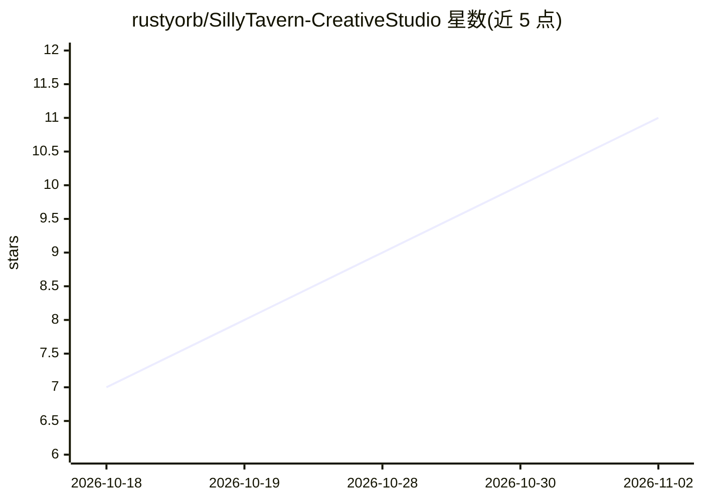

# rustyorb/SillyTavern-CreativeStudio

⭐ 11 · JavaScript · AGPL-3.0 · 推送 2026-10-19 · [GitHub](https://github.com/rustyorb/SillyTavern-CreativeStudio) · [官网](https://github.com/rustyorb/SillyTavern-CreativeStudio) · 个人维护

**SillyTavern 扩展：从一句话生成完整角色扮演套件**

SillyTavern 1.19+ 的角色创作扩展：从一句话或随机起点，经十个写作阶段生成彼此链接的 Character Card V3、开场白、世界书、预设、正则、Quick Replies 与图像提示词，可配 ComfyUI 生成头像与表情立绘。支持逐字段 Ask AI（续写/重写/三选一）、双角色 Remix、直接编辑/审阅两种 AI 落稿模式，全程可撤销并记录模型与提示历史。导入、手工编辑与导出无需 AI 连接；通过 SillyTavern 扩展菜单或 git clone 安装，无构建步骤，AGPL-3.0。

## 筛选速览

| 维度 | 判定 | 备注 |
|---|---|---|
| AI 角色 | `ai-native` | 本体是模型或模型工具 |
| 许可风险 | `viral` | AGPL-3.0 |
| 部署形态 | `library` | 以包/库形式分发 |
| 模型依赖 | — | README 未给出锁定关系 |
| 硬件要求 | — | 无带数字的原话,不猜 |
| 安装摩擦 | `low` | 无编译、无系统依赖或容器化 |
| 成熟度 | — | 结构信号不足 |

## 能力要点

- 十阶段流水线生成卡片/开场白/世界书/预设/正则/Quick Replies 等成套联动产物
- 逐字段 Ask AI：续写、重写、三版本对比，可勾选引用此前字段
- 双角色 Remix 生成新角色，支持锁定细节与字段字数下限
- 撤销/快照/来源记录（模型与提示历史），失败步骤可 Resume

## 适用场景

- 从一个想法快速搭建完整的 SillyTavern 角色扮演套件
- 在现有角色卡上让 AI 逐字段润色或扩写
- 把两个已有角色混合成一个新角色
- 为角色生成头像与表情立绘（配 ComfyUI）

## 场景标签

 · 领域:AI 角色扮演/创意写作工具

## 证据(README 行号)

> L13: A SillyTavern extension for importing, writing and improving characters, with optional AI help.
> L36: **Creative Studio can build the whole toolkit.** Open **Home → Generate with AI**, choose **Complete toolkit**,
> L133: |**Card**|Description, personality, scenario, first message, example dialogue, tags|Character Card V3 fields|

## 星数曲线

2026-10-18 7 → 2026-11-02 11（+4）

---
*卡片 v1 · prompt 1.4 · 生成 2026-11-02 · 置信度 mid · 依据 README sha `fc3f389c342c` · [字段定义](../../DATASET.md)*
