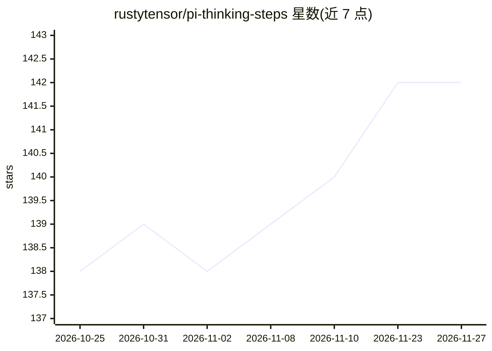

# rustytensor/pi-thinking-steps

⭐ 142 · TypeScript · MIT · 推送 2026-11-16 · [GitHub](https://github.com/rustytensor/pi-thinking-steps) · [官网](https://www.npmjs.com/package/pi-thinking-steps) · 个人维护

**Pi 终端扩展：以三种模式结构化展示模型推理步骤**

面向 Pi（终端 AI 代理）的 TypeScript 扩展，将提供商返回的推理流渲染为 TUI 面板，提供 collapsed/summary/expanded 三种显示模式、可切换的 token 速率页脚（Alt+Shift+T）。支持通过 /thinking-steps 命令导出会话推理树为 JSON/Markdown（含分支结构、模式 0600 权限），提供只读的会话内 review 浏览器、verbatim 查看与字面量搜索。不改动原文、不生成推理内容，无法恢复被提供商隐藏的思考块；导出功能要求持久化会话。

## 筛选速览

| 维度 | 判定 | 备注 |
|---|---|---|
| AI 角色 | `ai-ecosystem` | LLM/agent 周边工具 |
| 许可风险 | `permissive` | MIT |
| 部署形态 | `library` | 以包/库形式分发 |
| 模型依赖 | — | README 未给出锁定关系 |
| 硬件要求 | — | 无带数字的原话,不猜 |
| 安装摩擦 | `low` | 无编译、无系统依赖或容器化 |
| 成熟度 | — | 结构信号不足 |

## 能力要点

- 三种思考面板模式：collapsed/summary/expanded，Alt+T 切换
- JSON/Markdown 导出会话推理树，支持当前分支或全部分支
- 只读 review 浏览器与 verbatim 原文查看、字面量搜索
- 会话/项目/全局三级模式持久化与恢复优先级

## 适用场景

- 在终端里快速浏览模型的长推理流程
- 导出会话推理记录供事后审阅
- 查看每条回复的输入/输出 token 速率

## 场景标签

`LLM 可观测性` · 领域:评测与运维

## 证据(README 行号)

> L5:  Faithful, terminal-native thinking visualization for Pi.
> L16: Pi already exposes provider thinking, but raw reasoning streams are hard to scan in a real terminal. Pi Thinking St
> L31: - **Three focused modes** — `collapsed`, `summary`, `expanded`

## 星数曲线

2026-10-25 138 → 2026-11-27 142（+4）

---
*卡片 v1 · prompt 1.4 · 生成 2026-11-27 · 置信度 high · 依据 README sha `d0475c0ea798` · [字段定义](../../DATASET.md)*
