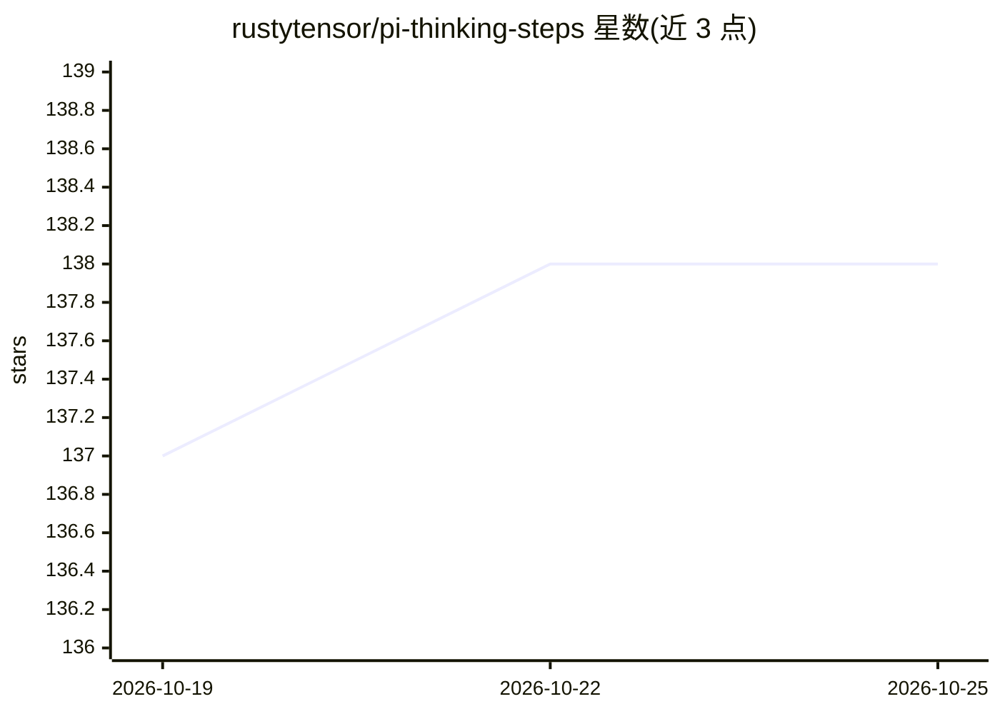

# rustytensor/pi-thinking-steps

⭐ 138 · TypeScript · MIT · 推送 2026-10-02 · [GitHub](https://github.com/rustytensor/pi-thinking-steps) · [官网](https://www.npmjs.com/package/pi-thinking-steps) · 个人维护

**Pi 终端推理可视化扩展：三种思维面板与会话审查树**

面向 Pi 的 TypeScript 终端扩展，将模型供应商的原始推理流渲染为 collapsed/summary/expanded 三种 TUI 面板，不生成或改写推理内容。支持会话级 JSON/Markdown 导出、Pi 内只读审查浏览器、逐字源查看、字面量搜索与分支响应对比，并提供会话/项目/全局三级模式持久化。默认关闭自动快照，导出含对话数据需自行审慎共享；工具均为只读快照，不调用模型或修改会话。

## 筛选速览

| 维度 | 判定 | 备注 |
|---|---|---|
| AI 角色 | `ai-ecosystem` | LLM/agent 周边工具 |
| 许可风险 | `permissive` | MIT |
| 部署形态 | `library` | 以包/库形式分发 |
| 模型依赖 | — | README 未给出锁定关系 |
| 硬件要求 | — | 无带数字的原话,不猜 |
| 安装摩擦 | `low` | 无编译、无系统依赖或容器化 |
| 成熟度 | — | 结构信号不足 |

## 能力要点

- collapsed/summary/expanded 三种终端思维显示模式
- 会话分支导出为 JSON（schema v1，父子 ID 树）与 Markdown
- Pi 内只读审查浏览器：逐字源、派生步骤与分支响应两栏对比
- 字面量、Unicode 感知、大小写不敏感的会话内搜索

## 适用场景

- 在终端实时跟踪模型的推理流而不读原始流文本
- 把推理过程导出为 JSON/Markdown 做归档与复核
- 对比同一提示在不同分支上的回答与思维文本
- 在思维文本中定位某段原文出处

## 场景标签

`LLM 可观测性` · 领域:评测与运维

## 证据(README 行号)

> L5:  Faithful, terminal-native thinking visualization for Pi.
> L16: Pi already exposes provider thinking, but raw reasoning streams are hard to scan in a real terminal. Pi Thinking St
> L156: All three tools are read-only TUI snapshots: they do not call a model, modify the session, change its branch, or e

## 星数曲线

2026-10-19 137 → 2026-10-25 138（+1）

---
*卡片 v1 · prompt 1.4 · 生成 2026-10-22 · 置信度 high · 依据 README sha `5447506d3c8d` · [字段定义](../../DATASET.md)*
