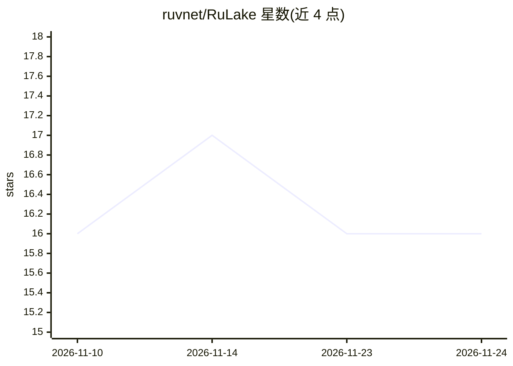

# ruvnet/RuLake

⭐ 16 · Rust · NOASSERTION · 推送 2026-11-19 · [GitHub](https://github.com/ruvnet/RuLake) · [官网](https://ruv.io) · 个人维护

**为 AI agent 提供自学习共享记忆层的向量执行织物**

位于向量存储/湖仓前端的记忆层：接入既有存储（S3、BigQuery、Snowflake、Parquet、文件），为多主机上的 agent 提供共享召回，随查询热度加速（约 1 ms/次），每次结果附带密码学回执以保证跨机一致性，底层数据变更时拒答。以 Rust crate、Python/Node 包及 WASM 形式分发，并提供 Claude Code 插件市场一键安装路径，内置 18 个检索、基因组、量子类工具。

## 筛选速览

| 维度 | 判定 | 备注 |
|---|---|---|
| AI 角色 | `ai-ecosystem` | LLM/agent 周边工具 |
| 许可风险 | `none` | NOASSERTION |
| 部署形态 | `library` | 以包/库形式分发 |
| 模型依赖 | — | README 未给出锁定关系 |
| 硬件要求 | — | 无带数字的原话,不猜 |
| 安装摩擦 | `low` | 无编译、无系统依赖或容器化 |
| 成熟度 | — | 结构信号不足 |

## 能力要点

- 指向既有存储即可为 agent 提供共享记忆，无需自建向量库
- 每次查询附带密码学回执，跨主机结果字节一致
- 底层数据变化时拒答而非给出过时结果
- 六插件架构（stack/core/substrates/kernels/witness/loop-vector）可组合

## 适用场景

- 为多主机协作的 agent 提供统一低延迟记忆
- 给 agent 查询结果加可验证回执以防数据被篡改
- 在浏览器/边缘运行时（Cloudflare Workers/Deno/Bun）部署记忆层

## 场景标签

`Agent 记忆` · 领域:Agent 开发

## 证据(README 行号)

> L17: ### Self-learning memory for your AI agents — without standing up a vector database.
> L19: ruLake gives your AI agents **memory that gets faster the more it's used.** Point it at the storage you already hav
> L34: # Claude Code, Cursor, Cline — install the marketplace (ADR-009)

## 星数曲线

2026-11-10 16 → 2026-11-24 16（+0）

---
*卡片 v1 · prompt 1.4 · 生成 2026-11-18 · 置信度 high · 依据 README sha `00116173a69a` · [字段定义](../../DATASET.md)*
