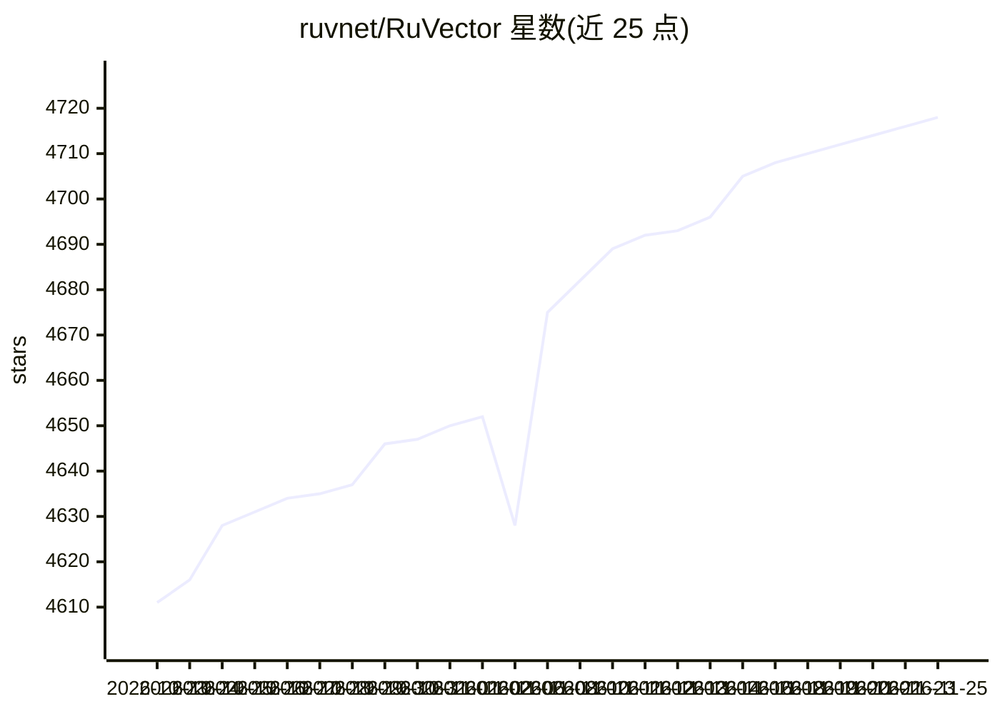

# ruvnet/RuVector

⭐ 4,718 · Rust · MIT · 推送 2026-11-23 · [GitHub](https://github.com/ruvnet/RuVector) · [官网](https://ruv.io) · 个人维护

**为 AI Agent 提供持久记忆与本地向量检索的 Rust 数据库**

Rust 实现的向量数据库与 Agent 记忆基座：提供本地语义嵌入、持久向量检索、图关系、基于显式反馈的学习与记忆生命周期控制。分发形态覆盖 npm 包（含 CLI 与 MCP 服务器）、Python 包（文档给出源码编译安装路径）与 crates.io 的 Rust crate，另有 WASM 浏览器组件与 typesafe 类型化决策引擎等独立子包。默认检索路径本地运行，首个语义命令会下载 all-MiniLM-L6-v2 嵌入模型；作者另提供商业企业层 Cognitum One。

## 筛选速览

| 维度 | 判定 | 备注 |
|---|---|---|
| AI 角色 | `ai-ecosystem` | LLM/agent 周边工具 |
| 许可风险 | `permissive` | MIT |
| 部署形态 | `library` | 以包/库形式分发 |
| 模型依赖 | — | README 未给出锁定关系 |
| 硬件要求 | — | 无带数字的原话,不猜 |
| 安装摩擦 | `low` | 无编译、无系统依赖或容器化 |
| 成熟度 | — | 结构信号不足 |

## 能力要点

- npm/PyPI/crates.io/WASM 多形态分发，MCP 服务器随 npm 包内置
- 本地语义嵌入与持久向量存储，跨进程重开存储路径可恢复数据
- @ruvector/typesafe 基于本地嵌入与决策头输出带置信度与弃权的类型化决策
- 支持显式反馈学习与记忆生命周期控制

## 适用场景

- 为跨会话的 Agent 保存并检索项目记忆
- 给 MCP 客户端（如 Claude Code）接入记忆工具
- 工单路由、意图分类等本地类型化决策任务
- 浏览器端向量检索与知识图谱检索实验

## 场景标签

`Agent 记忆` `向量数据库` `知识图谱` · 领域:Agent 开发

## 证据(README 行号)

> L5: RuVector is a Rust native substrate for fast local decisions and agent memory across sessions. It combines local sem
> L29: |**System 2: Reason & Orchestrate**|Reconstruct multi step context, coordinate work, and govern execution|RuvLLM, R
> L61: The MCP server is included in the `ruvector` npm package.

## 星数曲线

2026-10-23 4,611 → 2026-11-25 4,718（+107）

---
*卡片 v1 · prompt 1.4 · 生成 2026-11-22 · 置信度 mid · 依据 README sha `dfae15258ccc` · [字段定义](../../DATASET.md)*
