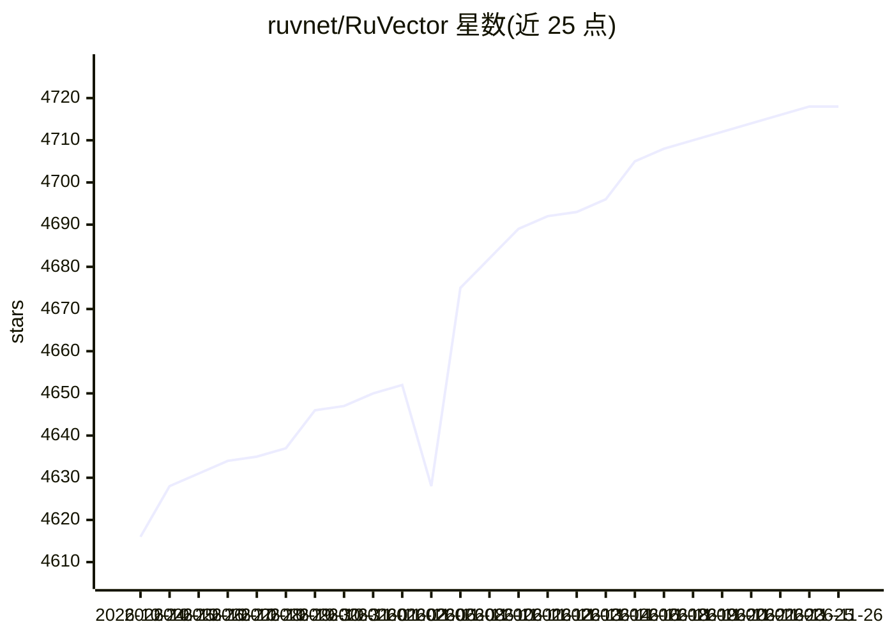

# ruvnet/RuVector

⭐ 4,718 · Rust · MIT · 推送 2026-11-25 · [GitHub](https://github.com/ruvnet/RuVector) · [官网](https://ruv.io) · 个人维护

**给 AI agent 提供持久记忆、向量检索与本地决策的 Rust 向量数据库**

以 Rust 为核心的向量检索与 agent 记忆底座：提供本地语义嵌入、持久化向量存储、图关系记忆、基于显式反馈的学习与记忆生命周期控制。按 System 0/1/2 分层组织组件，分发渠道覆盖 npm（含 CLI 与 MCP server）、PyPI 源码安装与 crates.io 的 Rust crate；另含 typesafe 本地分类决策引擎、浏览器 WASM 版本与交互式 Explorer。默认检索路径本地运行，托管服务可选。

## 筛选速览

| 维度 | 判定 | 备注 |
|---|---|---|
| AI 角色 | `ai-ecosystem` | LLM/agent 周边工具 |
| 许可风险 | `permissive` | MIT |
| 部署形态 | `library` | 以包/库形式分发 |
| 模型依赖 | — | README 未给出锁定关系 |
| 硬件要求 | — | 无带数字的原话,不猜 |
| 安装摩擦 | `low` | 无编译、无系统依赖或容器化 |
| 成熟度 | — | 结构信号不足 |

## 能力要点

- 跨进程持久的 agent 记忆（npm CLI / Node.js / Rust / Python 多接口）
- 内置 MCP server，可接入 Claude Code 等 MCP 客户端并区分读写权限 profile
- 本地嵌入（all-MiniLM-L6-v2）语义检索，首个语义命令下载模型
- @ruvector/typesafe 本地 typed 决策（choice/score/abstain），附基准数据与免责说明
- 浏览器 WASM 向量搜索与知识图谱组件（graph-node、kge）

## 适用场景

- 为跨会话运行的 agent 保存并检索项目上下文
- 通过 MCP 让 Claude Code 读写项目记忆
- 工单路由、意图分类等无需调用大模型的本地决策
- 在浏览器内嵌入向量插入与查询

## 场景标签

`Agent 记忆` `向量数据库` `知识图谱` · 领域:Agent 开发

## 证据(README 行号)

> L5: RuVector is a Rust native substrate for fast local decisions and agent memory across sessions. It combines local sem
> L42: |MCP via npm `ruvector`|Give an MCP client access to RuVector tools|Node.js, npm, and an MCP compatible client|
> L74: Configure your MCP client to launch `npx` with arguments `ruvector mcp start`, environment `RUVECTOR_MCP_PROFILE=re

## 星数曲线

2026-10-24 4,616 → 2026-11-26 4,718（+102）

---
*卡片 v1 · prompt 1.4 · 生成 2026-11-26 · 置信度 high · 依据 README sha `9b466c2eda64` · [字段定义](../../DATASET.md)*
