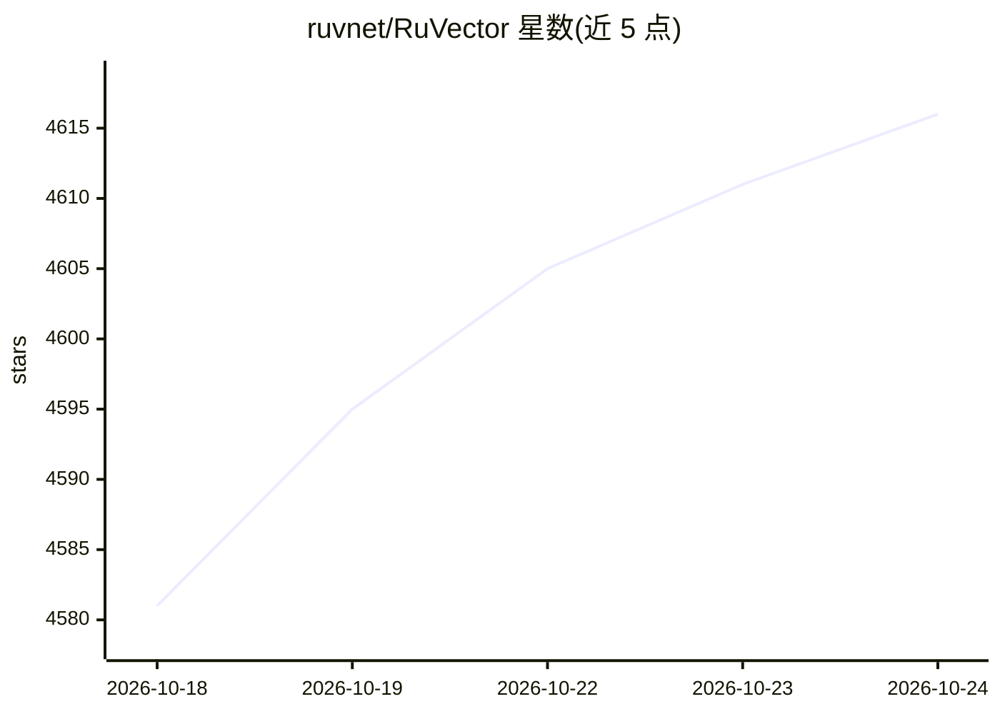

# ruvnet/RuVector

⭐ 4,616 · Rust · MIT · 推送 2026-10-23 · [GitHub](https://github.com/ruvnet/RuVector) · [官网](https://Cognitum.One/RuVector) · 个人维护

**Rust 编写的本地向量检索与持久化 agent 记忆库**

RuVector 是 Rust 原生的向量搜索与 agent 记忆基座，提供持久向量存储与检索、本地语义嵌入（ONNX，默认缓存 all-MiniLM-L6-v2）、图关系记忆、显式反馈学习（SONA、对比学习）与记忆生命周期控制。分发渠道包括 npm CLI/SDK（含 MCP server）、PyPI 源码安装与 crates.io 的 ruvector-core；另有 typesafe 本地类型化决策包、浏览器 WASM、图与 RVF 组件等独立包。默认检索路径在本地运行，基准数字被声明为工作负载相关而非通用保证。

## 筛选速览

| 维度 | 判定 | 备注 |
|---|---|---|
| AI 角色 | `ai-ecosystem` | LLM/agent 周边工具 |
| 许可风险 | `permissive` | MIT |
| 部署形态 | `library` | 以包/库形式分发 |
| 模型依赖 | — | README 未给出锁定关系 |
| 硬件要求 | — | 无带数字的原话,不猜 |
| 安装摩擦 | `low` | 无编译、无系统依赖或容器化 |
| 成熟度 | — | 结构信号不足 |

## 能力要点

- 跨进程持久向量存储与语义/哈希两种嵌入模式
- npm 包内置 MCP server，可配置 readonly 档位接入 MCP 客户端
- System 0/1/2 分层：本地决策（typesafe）、记忆学习（VectorDB/SONA）、推理编排（RuvLLM/RVF）
- Python 路径为源码安装，需 Rust 工具链

## 适用场景

- 为 Node.js/Python/Rust 应用嵌入持久 agent 记忆
- 通过 MCP 让 Claude Code 等客户端检索项目上下文
- 本地类型化决策如工单路由与意图分类

## 场景标签

`Agent 记忆` `向量数据库` · 领域:Agent 开发

## 证据(README 行号)

> L5: RuVector is a Rust native substrate for fast local decisions and agent memory across sessions. It combines local sem
> L61: The MCP server is included in the `ruvector` npm package.
> L185: |Search vectors or retain agent context|`ruvector` Node.js SDK, `ruvector-core` Rust crate|

## 星数曲线

2026-10-18 4,581 → 2026-10-24 4,616（+35）

---
*卡片 v1 · prompt 1.4 · 生成 2026-10-20 · 置信度 high · 依据 README sha `3bd32fb2efb8` · [字段定义](../../DATASET.md)*
