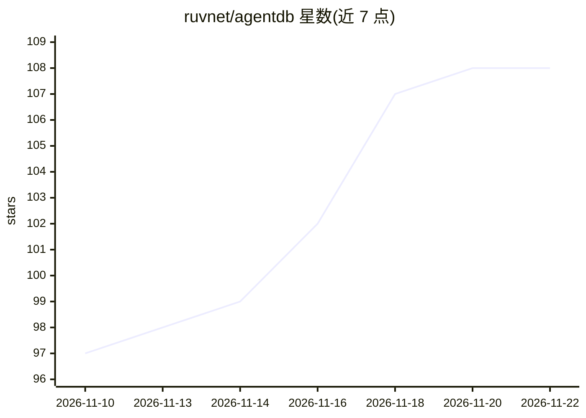

# ruvnet/agentdb

⭐ 108 · TypeScript · MIT · 推送 2026-11-11 · [GitHub](https://github.com/ruvnet/agentdb) · [官网](https://ruv.io) · 个人维护

**面向 agent 的自学习向量记忆库：单文件存储+HNSW+MCP**

AgentDB 是一个面向 AI agent 的向量记忆与检索库，将向量、索引、学习状态与审计日志保存在单个 .rvf 文件中，底层为 Rust 实现的 ruvector 引擎（NAPI 绑定）。核心机制：基于反馈信号（recordFeedback）由 Thompson Sampling bandit 自适应调整排序、RL 算法选择、压缩层级与技能组合，README 称检索质量可提升最多 36%；支持 BM25+稠密向量混合检索、HNSW、因果图与技能库等 6 类记忆模式。提供 npm 库、CLI（npx agentdb）与 MCP server 三种使用方式，注册 41 个 MCP 工具，可被 Claude Code、Cursor、Cline 等客户端调用。要求 Node.js 20.9.0+，支持浏览器（WASM）与边缘运行时，可离线运行；默认嵌入使用本地 Transformers 模型。限制：不依赖 LLM API 即可运行，部分原生集成为可选依赖（有 JS 回退）。

## 筛选速览

| 维度 | 判定 | 备注 |
|---|---|---|
| AI 角色 | `ai-ecosystem` | LLM/agent 周边工具 |
| 许可风险 | `permissive` | MIT |
| 部署形态 | `self-host` | docker 或自建部署 |
| 模型依赖 | — | README 未给出锁定关系 |
| 硬件要求 | — | 无带数字的原话,不猜 |
| 安装摩擦 | `low` | 无编译、无系统依赖或容器化 |
| 成熟度 | — | 结构信号不足 |

## 能力要点

- 单文件 .rvf 存储向量、索引、学习状态与审计日志
- 反馈驱动的 bandit 自学习检索（README 称最多 +36% 质量提升）
- BM25+稠密向量混合检索与 HNSW 索引，PQ8/PQ4/二值量化
- 提供 npm 库、CLI 与 41 工具的 MCP server 三种接入方式

## 适用场景

- 为 LLM agent（Claude Code/Cursor/Cline）外挂持久化记忆与检索
- 在 Node 应用中嵌入带自学习排序的向量存储
- 离线或边缘环境运行单文件向量库，无需服务端与 API key

## 场景标签

`Agent 记忆` `向量数据库` · 领域:Agent 开发

## 证据(README 行号)

> L13: agentdb: agent event → episodic memory → HNSW recall → MCP tools
> L58: |**Install**|`npm i agentdb`|`npx agentdb …` (no install)|`claude mcp add agentdb -- npx agentdb mcp start`|
> L167: 41 tools across six families, all callable from Claude Code, Cursor, Cline, or any MCP-compatible client:

## 星数曲线

2026-11-10 97 → 2026-11-22 108（+11）

---
*卡片 v1 · prompt 1.4 · 生成 2026-11-17 · 置信度 mid · 依据 README sha `c9a60c130f99` · [字段定义](../../DATASET.md)*
