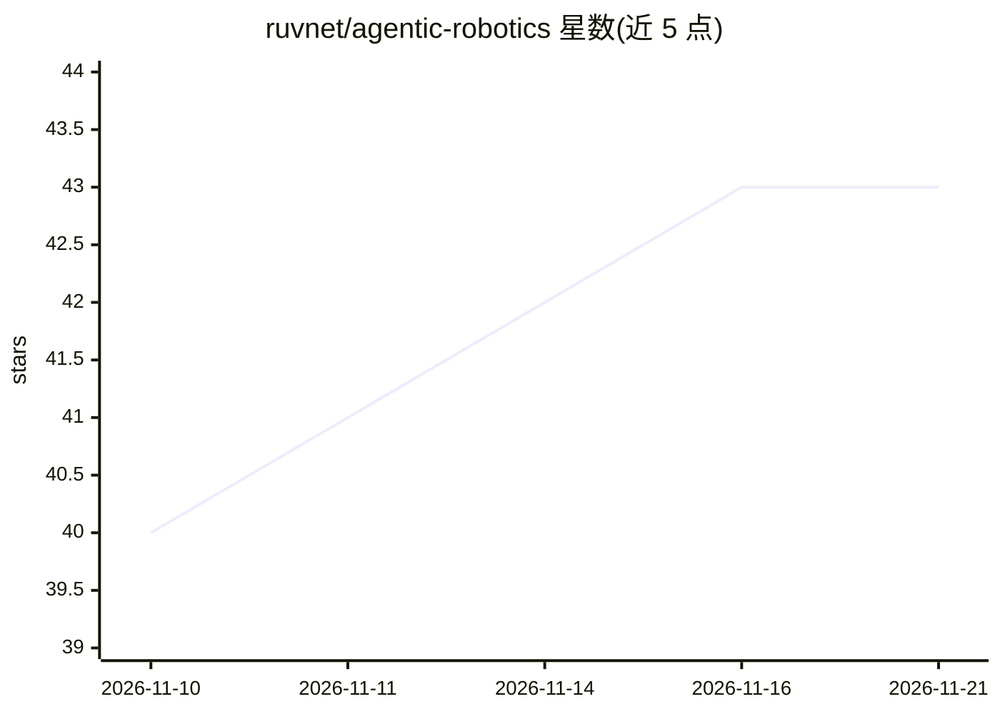

# ruvnet/agentic-robotics

⭐ 43 · TypeScript · MIT · 推送 2026-11-11 · [GitHub](https://github.com/ruvnet/agentic-robotics) · [官网](https://ruv.io) · 个人维护

**面向机器人开发者的 Agentic 框架：Rust 核心+LLM/MCP 集成**

模块化机器人开发框架：Rust 核心提供发布/订阅、实时执行器等中间件，通过 NAPI-RS 提供 Node.js 绑定，并附带 MCP 服务器（21 个 AI 工具），可通过 Claude Desktop 等以自然语言控制机器人。宣称支持多机器人集群协调、基于 AgentDB 的经验记忆与技能整合，并可与现有 ROS2 系统并行工作。以 npm 包与 Rust crate 双形态分发，平台二进制覆盖 Linux x64/ARM64 与 macOS。README 含性能数字与多项未完成路线图（Windows、Python 绑定、Docker 等列为待做）。

## 筛选速览

| 维度 | 判定 | 备注 |
|---|---|---|
| AI 角色 | `ai-ecosystem` | LLM/agent 周边工具 |
| 许可风险 | `permissive` | MIT |
| 部署形态 | `library` | 以包/库形式分发 |
| 模型依赖 | — | README 未给出锁定关系 |
| 硬件要求 | — | 无带数字的原话,不猜 |
| 安装摩擦 | `low` | 无编译、无系统依赖或容器化 |
| 成熟度 | — | 结构信号不足 |

## 能力要点

- 21 个 MCP 工具，支持通过 Claude/GPT-4 自然语言控制机器人
- Rust 核心 + NAPI-RS 的 Node.js 绑定，npm 安装并自动附带平台二进制
- 多机器人协调模式与 AgentDB 经验记忆/技能整合
- ROS2 兼容桥接，可与现有 ROS2 系统并行

## 适用场景

- 开发自主配送、巡检等机器人应用
- 通过 Claude Desktop 用自然语言指挥机器人
- 多机器人仓库/车队任务的协调分配

## 场景标签

`Agent 框架` `多智能体` · 领域:Agent 开发

## 证据(README 行号)

> L16: **Agentic Robotics** is a revolutionary framework that bridges the gap between traditional robotics and modern AI. 
> L51: - **21 MCP Tools**: Pre-built AI tools for robot control, sensing, planning, and learning
> L68: - **ROS2 Bridge**: Works alongside existing ROS2 systems (no migration required)

## 星数曲线

2026-11-10 40 → 2026-11-21 43（+3）

---
*卡片 v1 · prompt 1.4 · 生成 2026-11-18 · 置信度 high · 依据 README sha `510f1a747d15` · [字段定义](../../DATASET.md)*
