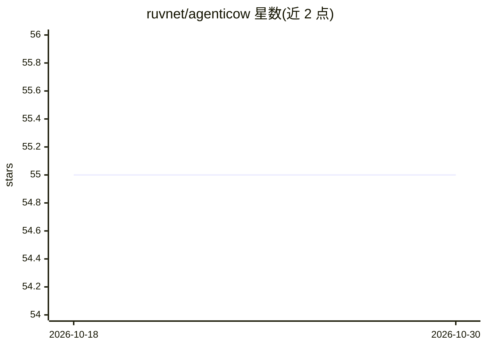

# ruvnet/agenticow

⭐ 55 · JavaScript · MIT · 推送 2026-07-04 · [GitHub](https://github.com/ruvnet/agenticow) · [官网](https://ruvnet.github.io/agenticow/) · 个人维护

**Agent 记忆的写时复制向量分支库：廉价分支/检查点/回滚**

面向多 Agent 记忆的嵌入式向量数据库，以写时复制（COW）方式对基础向量记忆做分支：创建分支约 0.5 ms / 162 字节，查询时透视为 parent ∪ edits（子分支优先，删除以墓碑处理）。提供 branch/checkpoint/rollback/diff/promote/fork 原语与 CLI，以 npm 包安装，进程内运行于单个 .rvf 文件，无需 DB 服务器。附示例覆盖个性化、隔离回滚、多租户 SaaS、GDPR 式删除等模式，并作为 @metaharness 生态的记忆平面与 jujutsu 代码平面通过 DualStateBridge 配对（可选 peer deps）。README 自陈部分模式为 PoC/roadmap 状态。

## 筛选速览

| 维度 | 判定 | 备注 |
|---|---|---|
| AI 角色 | `ai-ecosystem` | LLM/agent 周边工具 |
| 许可风险 | `permissive` | MIT |
| 部署形态 | `library` | 以包/库形式分发 |
| 模型依赖 | — | README 未给出锁定关系 |
| 硬件要求 | — | 无带数字的原话,不猜 |
| 安装摩擦 | `low` | 无编译、无系统依赖或容器化 |
| 成熟度 | — | 结构信号不足 |

## 能力要点

- COW 分支：~0.5 ms / 162 字节，与基础库大小无关
- branch/checkpoint/rollback/diff/promote/fork 原语与 CLI
- 进程内单 .rvf 文件运行，无需服务器与网络
- lineage 审计与按用户分支的删除（GDPR 式）

## 适用场景

- 多 Agent 共享一个基础记忆，各自 fork 私有分支
- 风险操作前做廉价检查点，失败时毫秒级回滚
- 为每个用户/租户做隔离的个性化记忆层
- Agent 记忆的 Git 式分支-评审-合并工作流

## 场景标签

`Agent 记忆` `向量数据库` · 领域:Agent 开发

## 证据(README 行号)

> L16: Every other vector store makes you **full-copy** the index to snapshot, fork, or checkpoint it. `agenticow` **branc
> L166: agenticow runs in-process over a single `.rvf` file — no DB server, no network.

## 星数曲线

2026-10-18 55 → 2026-10-30 55（+0）

---
*卡片 v1 · prompt 1.4 · 生成 2026-10-24 · 置信度 high · 依据 README sha `96f54486aa71` · [字段定义](../../DATASET.md)*
