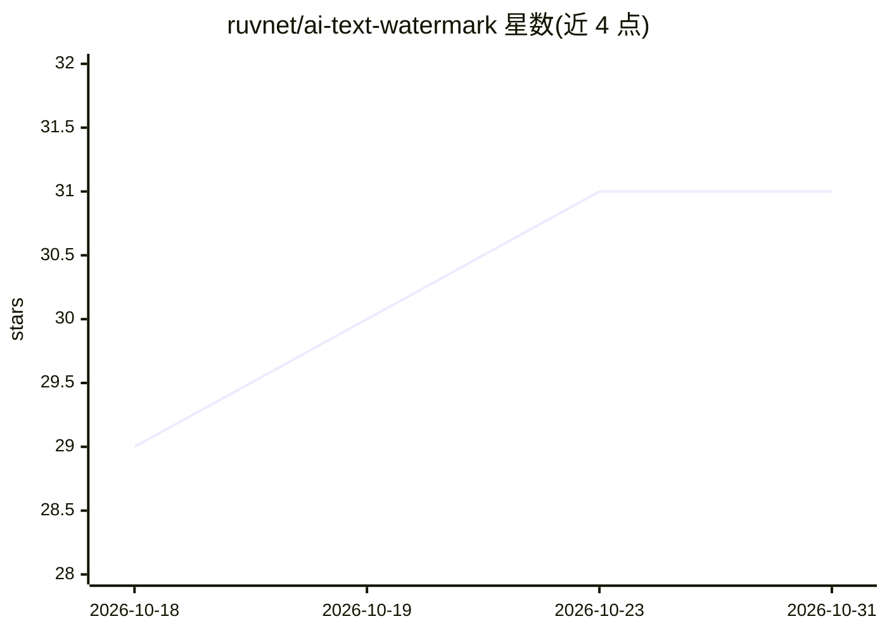

# ruvnet/ai-text-watermark

⭐ 31 · Rust · MIT · 推送 2026-08-16 · [GitHub](https://github.com/ruvnet/ai-text-watermark) · 个人维护

**给 LLM 生成文本嵌入与检测密钥可验证水印的 Rust/WASM 库**

实现 SynthID-Text 风格的文本水印：在模型采样时以密钥替换随机性，把不可见统计签名写入词语选择，事后持密钥检测（zScore/pValue 等）。提供 gumbel/tournament 等方案、流式代理 StreamProxy（接收 logits 或 top-k 概率）、生成中检测 MidStream、多比特 provenance 载荷嵌入。以 npm 包（Node/浏览器 WASM，37 KB）与 Rust crate 分发，附带浏览器在线 playground。限制：不做事后打标或去除水印；短文本标记弱。

## 筛选速览

| 维度 | 判定 | 备注 |
|---|---|---|
| AI 角色 | `ai-ecosystem` | LLM/agent 周边工具 |
| 许可风险 | `permissive` | MIT |
| 部署形态 | `library` | 以包/库形式分发 |
| 模型依赖 | local-ok | 支持本地模型 |
| 硬件要求 | — | 无带数字的原话,不猜 |
| 安装摩擦 | `low` | 无编译、无系统依赖或容器化 |
| 成熟度 | — | 结构信号不足 |

## 能力要点

- gumbel 默认方案为可证无损（不改变词分布）
- StreamProxy 接收 logits/top-k 概率，适配任意 tokenizer/模型
- 多比特 provenance 载荷嵌入与浏览器端恢复
- 检测速度约 10M tokens/sec，核心零依赖，46 个 Rust 测试

## 适用场景

- 为 EU AI Act 透明性合规标记模型输出
- 平台批量检测疑似 AI 生成文本段落
- 从训练数据中检测并排除自家模型输出
- 检查某段文本是否使用了自家密钥生成

## 场景标签

 · 领域:LLM 基础设施/内容溯源

## 证据(README 行号)

> L74: `StreamProxy` drops into a decode loop between the model and the emitted token.
> L75: Give it a step's raw **logits** (what a serving stack produces) or a truncated
> L157: - ⚡ **Fast** — single-digit microseconds per token to generate; ~10M tokens/sec to detect.

## 星数曲线

2026-10-18 29 → 2026-10-31 31（+2）

---
*卡片 v1 · prompt 1.4 · 生成 2026-10-26 · 置信度 high · 依据 README sha `096e6a219da6` · [字段定义](../../DATASET.md)*
