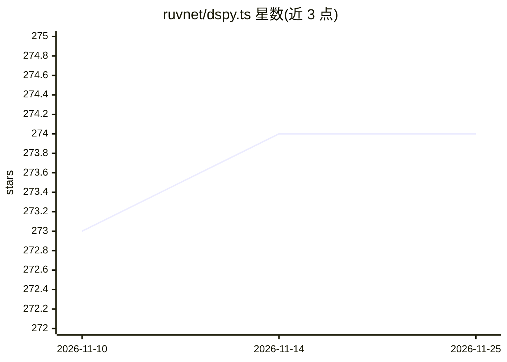

# ruvnet/dspy.ts

⭐ 274 · TypeScript · MIT · 推送 2026-11-11 · [GitHub](https://github.com/ruvnet/dspy.ts) · [官网](https://ruv.io) · 个人维护

**TypeScript LLM 编程框架：自动优化提示词与构建 RAG/Agent 管线**

受 DSPy 启发的 TypeScript LLM 应用框架：以类型化签名定义任务，组合 Predict/ChainOfThought/ReAct/Retrieve/Pipeline 等模块，用 BootstrapFewShot、MIPROv2、GEPA 优化器基于示例与评分函数自动搜索指令和示例，并在留出集上评估。底层 AgentDBClient 提供向量存储（可选 agentdb ≥3.7.2 后端，否则内存余弦扫描）、分层记忆、模糊 LM 缓存与编译追踪。支持 Node.js ≥18（CJS/ESM），多 LM 提供方（OpenAI/Anthropic/ONNX 等），快速示例可离线运行。已知限制包括 ONNX generate() 未返回完整文本、层级与量化状态重开后不恢复等。

## 筛选速览

| 维度 | 判定 | 备注 |
|---|---|---|
| AI 角色 | `ai-ecosystem` | LLM/agent 周边工具 |
| 许可风险 | `permissive` | MIT |
| 部署形态 | `library` | 以包/库形式分发 |
| 模型依赖 | — | README 未给出锁定关系 |
| 硬件要求 | — | 无带数字的原话,不猜 |
| 安装摩擦 | `low` | 无编译、无系统依赖或容器化 |
| 成熟度 | `idea` | |

## 能力要点

- 类型化签名 + 可组合模块（Predict/ChainOfThought/ReAct/Retrieve/Pipeline）
- BootstrapFewShot/MIPROv2/GEPA 三种提示词优化器，确定性 seed，支持 save/load
- AgentDBClient 向量存储：过滤检索、RaBitQ 量化、分层记忆、模糊 LM 缓存
- 快速示例使用 DummyLM 离线运行，无需 API key

## 适用场景

- 把反复手工调提示词变成带度量与评估的开发循环
- 用 TypeScript 构建 RAG 问答与工具调用 Agent 管线
- 跨编译运行复用优化经验（MIPROv2 重放 / GEPA 前沿暖启动）

## 场景标签

`提示工程` `RAG` `Agent 框架` · 领域:Agent 开发

## 证据(README 行号)

> L15: DSPy.ts is a **TypeScript framework for LLM applications and automatic prompt optimization**, inspired by DSPy. Def
> L21: Turn repeated prompt editing into a measurable development loop. `BootstrapFewShot`, `MIPROv2` and `GEPA` search in

## 星数曲线

2026-11-10 273 → 2026-11-25 274（+1）

---
*卡片 v1 · prompt 1.4 · 生成 2026-11-17 · 置信度 high · 依据 README sha `0b7bb2eb6789` · [字段定义](../../DATASET.md)*
