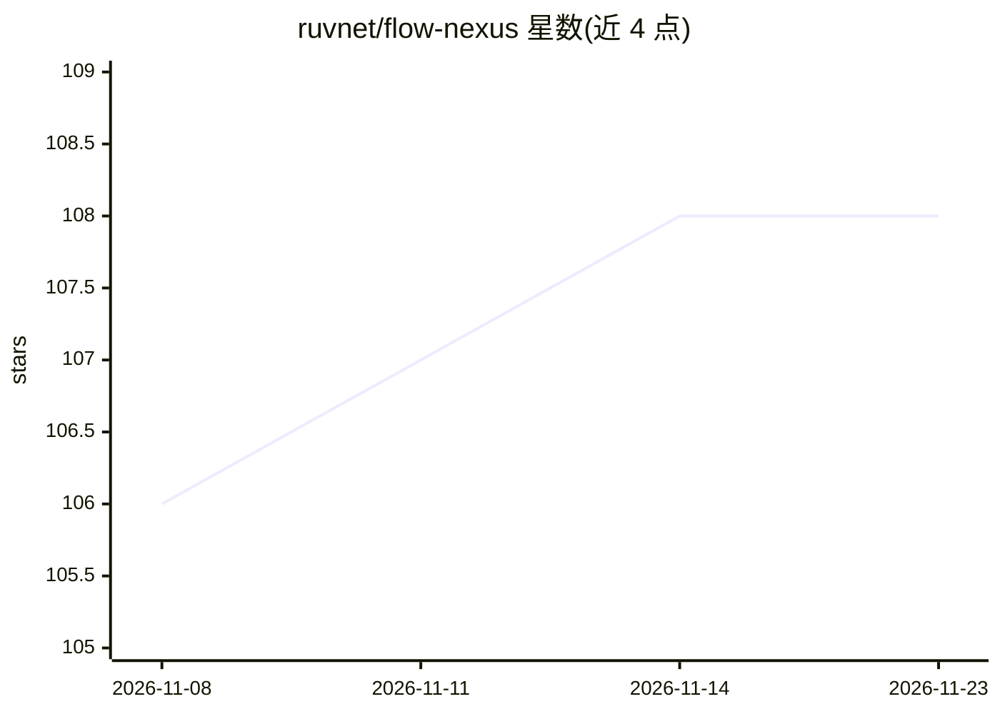

# ruvnet/flow-nexus

⭐ 108 · JavaScript · 推送 2026-11-06 · [GitHub](https://github.com/ruvnet/flow-nexus) · [官网](https://ruv.io) · 个人维护

**基于 MCP 的竞技型 agent 平台：云端部署 agent 集群并赚取积分**

Flow Nexus 是构建在 MCP（Model Context Protocol）之上的云端 agentic 平台，通过三个 MCP 服务器提供自主 agent 集群部署、秒级隔离沙箱、分布式神经网络训练、事件驱动工作流与 70+ MCP 工具。用户通过 Claude Code/Desktop、OpenAI Codex、Cursor、GitHub Copilot 等 MCP 客户端接入。内置 rUv 积分经济系统、AI 裁判（Queen Seraphina）、代码竞技场、模板市场与排行榜，新用户赠送 256 积分。以 npm 包形式分发（npx flow-nexus）。

## 筛选速览

| 维度 | 判定 | 备注 |
|---|---|---|
| AI 角色 | `ai-ecosystem` | LLM/agent 周边工具 |
| 许可风险 | `none` | — |
| 部署形态 | `library` | 以包/库形式分发 |
| 模型依赖 | — | README 未给出锁定关系 |
| 硬件要求 | — | 无带数字的原话,不猜 |
| 安装摩擦 | `low` | 无编译、无系统依赖或容器化 |
| 成熟度 | — | 结构信号不足 |

## 能力要点

- 通过 MCP 服务器部署自主 agent 集群与隔离沙箱（<1 秒部署）
- 分布式神经网络训练与 WASM/SIMD 加速
- 70+ MCP 工具覆盖模板、挑战、监控、存储、支付等
- rUv 积分经济系统：竞技场、排行榜、模板市场 royalties

## 适用场景

- 在云端沙箱中运行 24/7 自主 agent 集群执行任务
- 通过 MCP 客户端（Claude Code/Cursor 等）调用平台工具
- 参加编码竞技挑战赚取积分并在模板市场发布作品获利

## 场景标签

`多智能体` `工作流自动化` · 领域:Agent 开发

## 证据(README 行号)

> L27: Flow Nexus combines the proven economics of cloud computing (pay-as-you-go, scale-on-demand) with the power of auto
> L31: Flow Nexus orchestrates three interconnected MCP servers to create a complete AI development ecosystem:
> L50: claude mcp add flow-nexus npx flow-nexus@latest mcp start

## 星数曲线

2026-11-08 106 → 2026-11-23 108（+2）

---
*卡片 v1 · prompt 1.4 · 生成 2026-11-18 · 置信度 high · 依据 README sha `92f8d0c2518b` · [字段定义](../../DATASET.md)*
