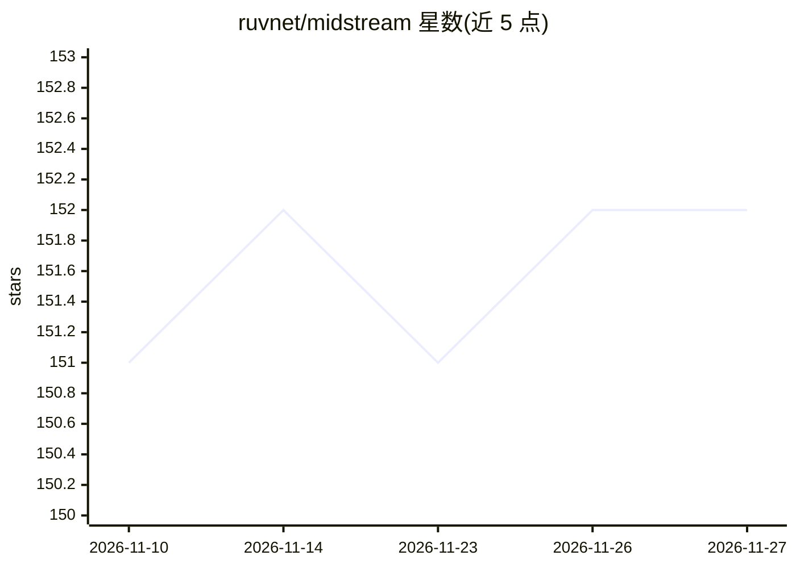

# ruvnet/midstream

⭐ 152 · Rust · Apache-2.0 · 推送 2026-11-23 · [GitHub](https://github.com/ruvnet/midstream) · [官网](https://ruv.io) · 个人维护

**Rust 实时分析 LLM 流式输出的工作区：边流式边匹配/评分/干预**

由 rUv 维护的 Rust workspace + WASM 绑定 + npm 包：将 LLM token 流视为一等信号，在其到达过程中做模式匹配、评分与干预。包含 6 个可独立使用的库（DTW/LCS 序列比较、纳秒级优先级调度器、动力学系统吸引子分析、LTL+神经推理、自指元学习 strange-loop、QUIC 多流传输）和一个将各库接入 OpenAI Realtime API 的演示二进制与 ratatui 控制台。支持编译到 wasm32 在浏览器/边缘运行时使用。要求 Rust MSRV 1.81。

## 筛选速览

| 维度 | 判定 | 备注 |
|---|---|---|
| AI 角色 | `ai-ecosystem` | LLM/agent 周边工具 |
| 许可风险 | `permissive` | Apache-2.0 |
| 部署形态 | `library` | 以包/库形式分发 |
| 模型依赖 | — | README 未给出锁定关系 |
| 硬件要求 | — | 无带数字的原话,不猜 |
| 安装摩擦 | `low` | 无编译、无系统依赖或容器化 |
| 成熟度 | — | 结构信号不足 |

## 能力要点

- 6 个独立发布的 crates.io 库组合为 inflight 分析管线
- WASM 同源码编译，支持浏览器与 Cloudflare Workers/Deno/Bun 边缘运行时
- QUIC 多流传输（quinn），secure-by-default TLS
- 41 份 ADR 记录架构决策，cargo audit/deny 供应链门禁

## 适用场景

- 在 LLM 响应流式输出过程中做实时意图检测与安全门控
- 在浏览器或边缘环境嵌入流式序列分析与调度能力
- 运行演示二进制观察意图检测、指标与情感分析管线

## 场景标签

`网络安全` · 领域:学习与行业

## 证据(README 行号)

> L16: Treat an LLM token stream as a first-class signal — pattern-match it, score it, intervene on it — *while the tokens
> L24: One workspace, six published libraries, one binary. The libraries are independently useful (pattern matching, real-
> L96: |⚡|**Inflight analysis**|Pattern-match, score, and gate LLM tokens as they arrive — not after the response complete

## 星数曲线

2026-11-10 151 → 2026-11-27 152（+1）

---
*卡片 v1 · prompt 1.4 · 生成 2026-11-17 · 置信度 high · 依据 README sha `e8b2744620d4` · [字段定义](../../DATASET.md)*
