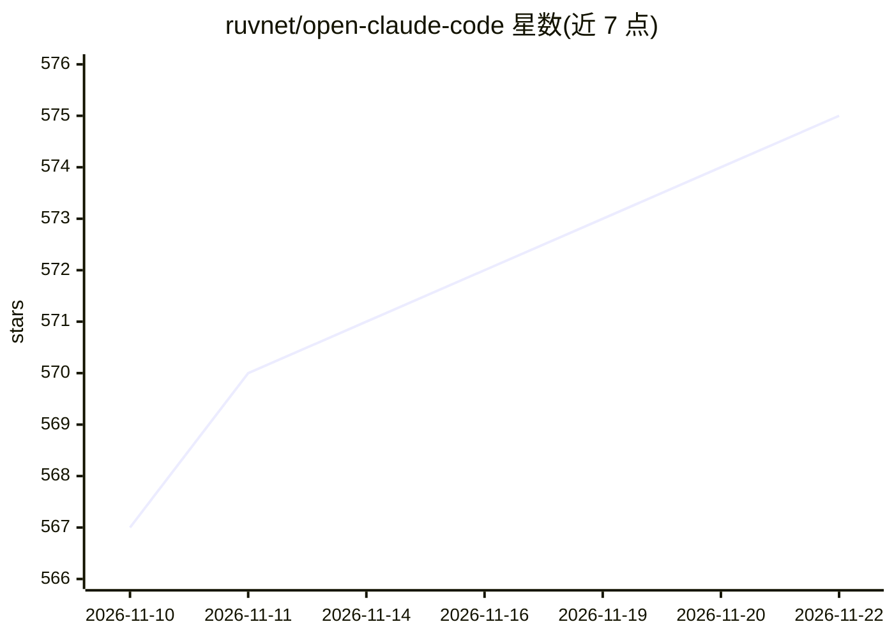

# ruvnet/open-claude-code

⭐ 575 · JavaScript · MIT · 推送 2026-11-21 · [GitHub](https://github.com/ruvnet/open-claude-code) · [官网](https://ruv.io) · 个人维护

**开源重建的 Claude Code CLI：清洁室复刻的编码 agent 命令行**

基于对已发布 npm 包的 AI 反编译分析（ruDevolution）以清洁室方式重建的开源 Claude Code CLI 实现，面向需要可自托管控的命令行编码 agent 的开发者。提供异步生成器 agent 循环、25 个内置工具、4 种 MCP 传输、6 种权限模式、hooks、会话与 40 个斜杠命令；支持 Anthropic、OpenAI 兼容端点与 Google 适配器，Bedrock/Vertex 仍为桩。README 明确声明与上游的完全对等尚未建立。

## 筛选速览

| 维度 | 判定 | 备注 |
|---|---|---|
| AI 角色 | `ai-native` | 本体是模型或模型工具 |
| 许可风险 | `permissive` | MIT |
| 部署形态 | `library` | 以包/库形式分发 |
| 模型依赖 | locked-api |  |
| 硬件要求 | — | 无带数字的原话,不猜 |
| 安装摩擦 | `low` | 无编译、无系统依赖或容器化 |
| 成熟度 | `idea` | |

## 能力要点

- 25 个内置工具与 4 种 MCP 传输（stdio/SSE/Streamable HTTP/WebSocket）
- 多供应商适配：Anthropic、OpenAI 兼容端点、Google
- 1,008 个单元测试与已安装包行为检查的发布门禁流水线
- 40 个 REPL 斜杠命令与 4 层设置加载链

## 适用场景

- 在命令行用自然语言驱动 agent 解释、修改、检索代码
- 需要源码可审计的 Claude Code 替代实现
- 通过 MCP 服务器扩展 agent 的外部工具

## 场景标签

`编码 Agent` · 领域:编码与开发

## 证据(README 行号)

> L102: **Open Claude Code** is a ground-up open source rebuild of Anthropic's Claude Code CLI, informed by ruDevolution's
> L106: **1,008 unit tests plus installed-package behavioral checks. Full upstream parity is not established.**
> L285: Adapters exist for Anthropic, OpenAI-compatible endpoints and Google. Installed-package E2E covers Anthropic and O

## 星数曲线

2026-11-10 567 → 2026-11-22 575（+8）

---
*卡片 v1 · prompt 1.4 · 生成 2026-11-17 · 置信度 high · 依据 README sha `bf059f6c4441` · [字段定义](../../DATASET.md)*
