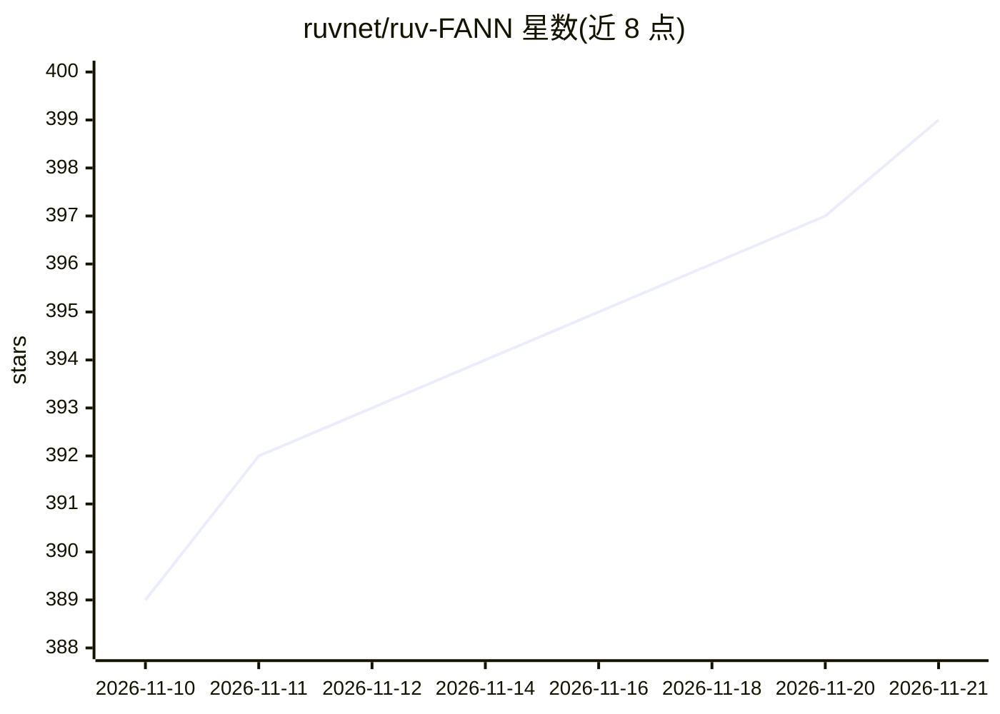

# ruvnet/ruv-FANN

⭐ 399 · Rust · MIT · 推送 2026-11-20 · [GitHub](https://github.com/ruvnet/ruv-FANN) · [官网](https://ruv.io) · 个人维护

**Rust/JS/WASM 小型神经网络库：权重编程与模型修订管理**

以 Rust 核心配 WebAssembly 运行时，在 Rust、JavaScript/TypeScript 与浏览器中构建、训练小型前馈网络并做推理（设计受 FANN 启发）。特色是权重空间编程（WSP）：对选定权重提出有界编辑，基于留出集与有限域检查独立评估候选，再显式提升或回滚模型修订；提供 Safetensors 检查点离线编辑 CLI、napi 原生绑定及 Candle 集成。同仓库另含预测、agent、CUDA 源码翻译与图像处理等独立工作区。包本身不调用 LLM、不执行生成代码，补丁与提升由应用控制。

## 筛选速览

| 维度 | 判定 | 备注 |
|---|---|---|
| AI 角色 | `ai-ecosystem` | LLM/agent 周边工具 |
| 许可风险 | `permissive` | MIT |
| 部署形态 | `library` | 以包/库形式分发 |
| 模型依赖 | — | README 未给出锁定关系 |
| 硬件要求 | — | 无带数字的原话,不猜 |
| 安装摩擦 | `medium` | 含编译或系统依赖之一 |
| 成熟度 | — | 结构信号不足 |

## 能力要点

- WSP 工作流：提出有界权重补丁→独立评估→显式 promote/rollback 修订
- npm 包通过 WebAssembly 运行 Rust 神经引擎，支持 Node.js 20.9+ 与浏览器
- ruv-fann-wsp-tensor CLI 流式编辑 F32/F16/BF16 Safetensors 检查点，哈希绑定回滚且不覆盖原文件
- 含激活检查、敏感性分析、12 个聚焦工具包及 Hub/Cloudflare 适配器

## 适用场景

- 在 Node.js 或浏览器中检查网络激活、训练并推理小型模型
- 对模型权重做受控修改并在上线前独立验证效果
- 管理模型修订：候选评估通过后显式提升，可回滚到字节级原状

## 场景标签

 · 领域:机器学习工具/神经网络

## 证据(README 行号)

> L3: Build, train and inspect small neural networks in **Rust, JavaScript, TypeScript and WebAssembly**. Use **weight-spa
> L35: |`packages/wsp/`|**`ruv-fann-wsp`**: inspect and trace models, build bounded weight patches, evaluate candidates, t
> L91: |Step|What the WSP package provides|What it tells you|

## 星数曲线

2026-11-10 389 → 2026-11-21 399（+10）

---
*卡片 v1 · prompt 1.4 · 生成 2026-11-17 · 置信度 high · 依据 README sha `e5b1d9871025` · [字段定义](../../DATASET.md)*
