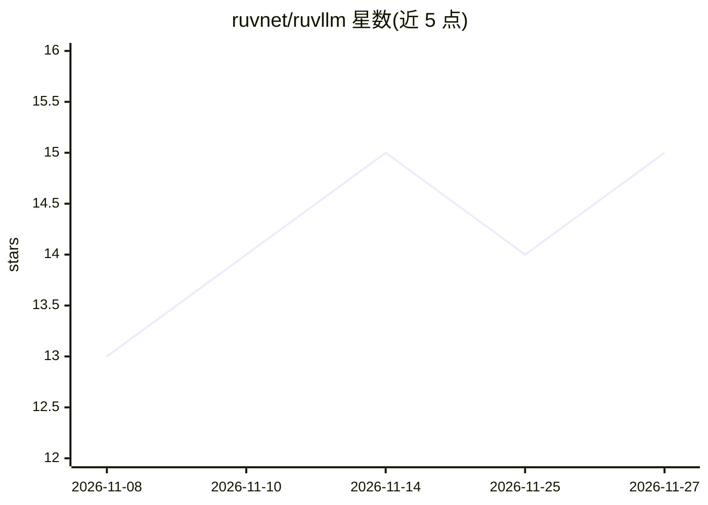

# ruvnet/ruvllm

⭐ 15 · Python · Apache-2.0 · 推送 2026-11-06 · [GitHub](https://github.com/ruvnet/ruvllm) · [官网](https://ruv.io) · 个人维护

**面向开发/研究的模型权重编辑与配对评测治理工具**

RuVLLM 在不改原始权重的前提下，对开源语言模型训练 LoRA 适配器或施加策略约束的直改编辑，然后让基准与候选在相同任务、同一 GPU 上配对作答，用精确 McNemar 检验并按预注册规则决定保留或拒绝，原始权重可逐字节恢复验证。提供 Rust 权重编辑器、npm GPU 租赁循环（含四重支出上限与销毁定时器）、Claude Code/Ruflo 插件以及 Apple Silicon 上 MLX 形式的 OpenAI 兼容本地服务。结果仅限 Qwen3.5 4B 的工具调用与算术面板，面向研究鉴定而非生产激活。

## 筛选速览

| 维度 | 判定 | 备注 |
|---|---|---|
| AI 角色 | `ai-ecosystem` | LLM/agent 周边工具 |
| 许可风险 | `permissive` | Apache-2.0 |
| 部署形态 | `library` | 以包/库形式分发 |
| 模型依赖 | — | README 未给出锁定关系 |
| 硬件要求 | — | 无带数字的原话,不猜 |
| 安装摩擦 | `medium` | 含编译或系统依赖之一 |
| 成熟度 | — | 结构信号不足 |

## 能力要点

- LoRA 适配器与策略约束直改两种编辑路径，原始权重逐字节恢复可验证
- 相同任务同 GPU 配对评测 + 精确 McNemar 检验 + 预注册保留规则
- GPU 租赁循环：四重支出上限、独立销毁定时器、确认清理
- Claude Code / Ruflo MCP 插件与 Apple Silicon MLX 的 OpenAI 兼容本地 API

## 适用场景

- 对编码模型做受控微调并证明改动无回归后再决定是否保留
- 在预算封顶的租赁 GPU 上跑可复现的配对评测
- 在 Mac 上本地运行带适配器的编码模型并接入 Claude Code Router

## 场景标签

`微调` `模型评测` `推理引擎` · 领域:评测与运维

## 证据(README 行号)

> L7: RuVLLM trains and edits small adapters for open language models, then measures each one against the unchanged base o
> L50: 2. **Change a copy.** Train a LoRA adapter or apply a bounded direct weight edit. The original file is never modifi
> L91: |Install the CLI|`npm install @ruvector/ruvllm-gpu-loop` then `npx ruvllm-gpu --help`|Node 22+|

## 星数曲线

2026-11-08 13 → 2026-11-27 15（+2）

---
*卡片 v1 · prompt 1.4 · 生成 2026-11-18 · 置信度 high · 依据 README sha `7b1bcb5ca03d` · [字段定义](../../DATASET.md)*
