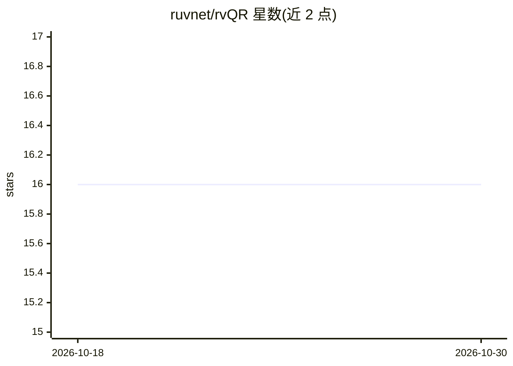

# ruvnet/rvQR

⭐ 16 · JavaScript · MIT · 推送 2026-08-04 · [GitHub](https://github.com/ruvnet/rvQR) · 个人维护

**离线光学传输工具：通过动画二维码在设备间传文件**

面向需要在无网络、无配对、无账号环境下跨设备传文件的用户：在发送端将 RVF 容器或 WASM 产物编码为连续动画二维码，接收端用摄像头（或照片上传、手动粘贴）逐帧解码，数据物理上从一块屏幕到达另一块屏幕。文件以 SHA-256 哈希校验，出错即整体拒绝。默认速率约 2.5 KB/s（最高 10 KB/s），定位是 KB 到低 MB 级传输而非大文件。附带 RVF 微内核解析、向量最近邻查询、增量发送与浏览器内 IndexedDB 制品库。以托管网页和单文件 standalone.html 两种方式运行，后者零网络请求。自我声明为 Alpha 阶段，部分功能仍在路线图上。

## 筛选速览

| 维度 | 判定 | 备注 |
|---|---|---|
| AI 角色 | `ai-enhanced` | 去掉 AI 部分产品仍成立 |
| 许可风险 | `permissive` | MIT |
| 部署形态 | `None` |  |
| 模型依赖 | — | README 未给出锁定关系 |
| 硬件要求 | — | 无带数字的原话,不猜 |
| 安装摩擦 | `low` | 无编译、无系统依赖或容器化 |
| 成熟度 | `idea` | |

## 能力要点

- 摄像头/照片/手动粘贴三种接收路径，无需网络与账号
- 逐帧 SHA-256 校验，单比特错误即整体拒绝
- 单文件 standalone.html（约 1.2 MB）零网络请求运行，适配物理隔离场景
- RVF WebAssembly 微内核解析容器并支持向量最近邻查询

## 适用场景

- 在没有 WiFi/蜂窝网络的隔离设备间传递小体积文件
- 跨设备搬运 RVF 容器与 WASM 产物并核验完整性
- 只发送变更部分（粗/细粒度 diff 自动择优）更新已持有的制品

## 场景标签

 · 领域:文件传输/离线工具

## 证据(README 行号)

> L3: **Move files between devices with a screen and a camera.**
> L31: rvQR is optical transfer of RVF cognitive containers and WASM artifacts. Open the same app on two devices. On the f

## 星数曲线

2026-10-18 16 → 2026-10-30 16（+0）

---
*卡片 v1 · prompt 1.4 · 生成 2026-10-30 · 置信度 high · 依据 README sha `bd453fc01abc` · [字段定义](../../DATASET.md)*
