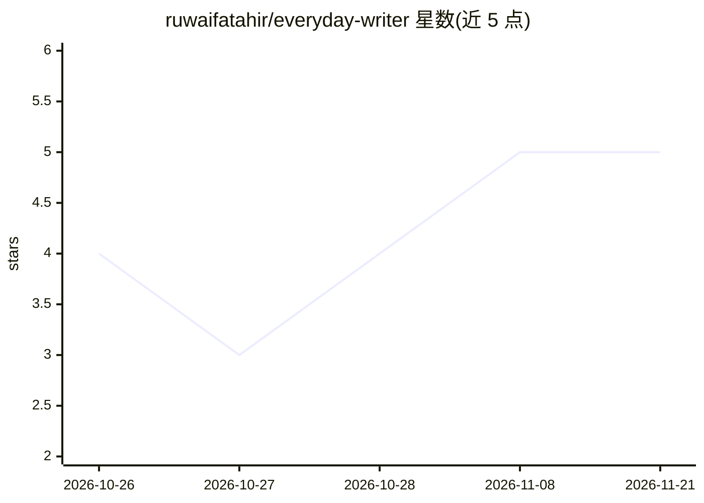

# ruwaifatahir/everyday-writer

⭐ 5 · Rust · Apache-2.0 · 推送 2026-11-20 · [GitHub](https://github.com/ruwaifatahir/everyday-writer) · [官网](https://everydaywriter.ruwaifa.xyz) · 个人维护

**Windows 全局快捷键文本改写工具，任意应用内修复文字**

基于 Tauri/Rust 的 Windows 桌面工具：在任意应用中选中文字后按快捷键（默认 Ctrl+Shift+Space），弹出窗口显示改写结果，确认后替换回原文。支持自定义自然语言指令集（如修复英语、对客户更礼貌、罗马乌尔都语转英语），可为聊天、工作邮件等场景保存多套指令并切换。模型接入由用户自备 API key，密钥存于 Windows Credential Manager；应用无账号无订阅。更新器每日检查 GitHub Releases，仅接受项目密钥签名的更新。

## 筛选速览

| 维度 | 判定 | 备注 |
|---|---|---|
| AI 角色 | `ai-native` | 本体是模型或模型工具 |
| 许可风险 | `permissive` | Apache-2.0 |
| 部署形态 | `None` |  |
| 模型依赖 | local-ok | 支持本地模型 |
| 硬件要求 | — | 无带数字的原话,不猜 |
| 安装摩擦 | `low` | 无编译、无系统依赖或容器化 |
| 成熟度 | — | 结构信号不足 |

## 能力要点

- 任意应用内选中文本、快捷键调用、原地替换
- 自定义自然语言改写指令集，可按场景切换
- 支持 OpenAI/Anthropic/Gemini/OpenRouter/本地 Ollama 及任意 OpenAI 兼容端点
- API key 存于 Windows Credential Manager，无账号无订阅

## 适用场景

- 聊天软件里快速修正消息的语法与拼写
- 把随意措辞改写成对客户更得体的邮件
- 将罗马乌尔都语输入转换为英文

## 场景标签

`AI 写作` · 领域:内容生成

## 证据(README 行号)

> L13: Select your text and press a shortcut. Everyday Writer fixes it, shortens it, makes it polite or makes it sound lik
> L42: - **Your choice of AI.** OpenAI, Anthropic, Gemini, OpenRouter, a local Ollama, or any OpenAI-compatible endpoint.

## 星数曲线

2026-10-26 4 → 2026-11-21 5（+1）

---
*卡片 v1 · prompt 1.4 · 生成 2026-11-21 · 置信度 high · 依据 README sha `f29d9ba451e7` · [字段定义](../../DATASET.md)*
