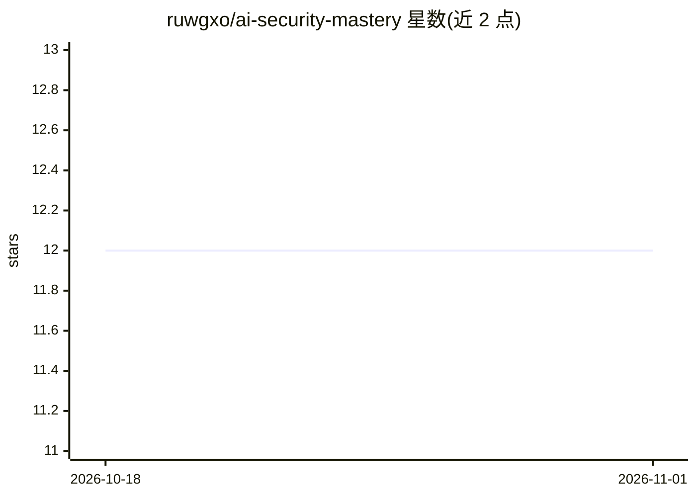

# ruwgxo/ai-security-mastery

⭐ 12 · MIT · 推送 2026-10-27 · [GitHub](https://github.com/ruwgxo/ai-security-mastery) · 个人维护

**面向安全从业者的 90 天 AI 安全实战教程（开源书）**

从 ML 基础到生产级 AI 安全系统的 90 天动手学习路径，共 18 章 270 节，内容以结构化 YAML 存放于 book/ 目录，可在线阅读或 git clone 后本地运行代码。覆盖提示注入、越狱、训练数据投毒、模型提取、对抗机器学习、检测工程与 SIEM 集成、生产部署等主题，附实现代码。限定 LLM 安全方向，计算机视觉、强化学习与联邦学习安全非主要议题。技术栈为 Python 3.12+、PyTorch、scikit-learn、Transformers、FastAPI、MLflow。v2.0 规划含 Agentic AI 安全与在线可执行 notebook。

## 筛选速览

| 维度 | 判定 | 备注 |
|---|---|---|
| AI 角色 | `ai-knowledge` | 知识聚合/清单类 |
| 许可风险 | `permissive` | MIT |
| 部署形态 | `library` | 以包/库形式分发 |
| 模型依赖 | — | README 未给出锁定关系 |
| 硬件要求 | — | 无带数字的原话,不猜 |
| 安装摩擦 | `low` | 无编译、无系统依赖或容器化 |
| 成熟度 | — | 结构信号不足 |

## 能力要点

- 18 章 270 节覆盖攻击面、检测层与生产部署
- 每节内联实现代码，可复制运行
- 结构化 YAML 书稿，支持在线阅读与本地克隆
- 附 Zenodo DOI 与 CITATION.cff 引用格式

## 适用场景

- 安全工程师系统学习 ML/LLM 安全攻防
- 构建 AI 攻击检测系统时参考实现
- 了解提示注入、越狱、数据投毒等攻击面与检测工程

## 场景标签

`教程课程` `网络安全` · 领域:学习与行业

## 证据(README 行号)

> L15: A hands-on learning path for security professionals entering AI security. Security-first, implementation-focused, a
> L35: ### Part 1 — ML Foundations (Weeks 1–3)

## 星数曲线

2026-10-18 12 → 2026-11-01 12（+0）

---
*卡片 v1 · prompt 1.4 · 生成 2026-11-01 · 置信度 mid · 依据 README sha `4a2e9b2a3b09` · [字段定义](../../DATASET.md)*
