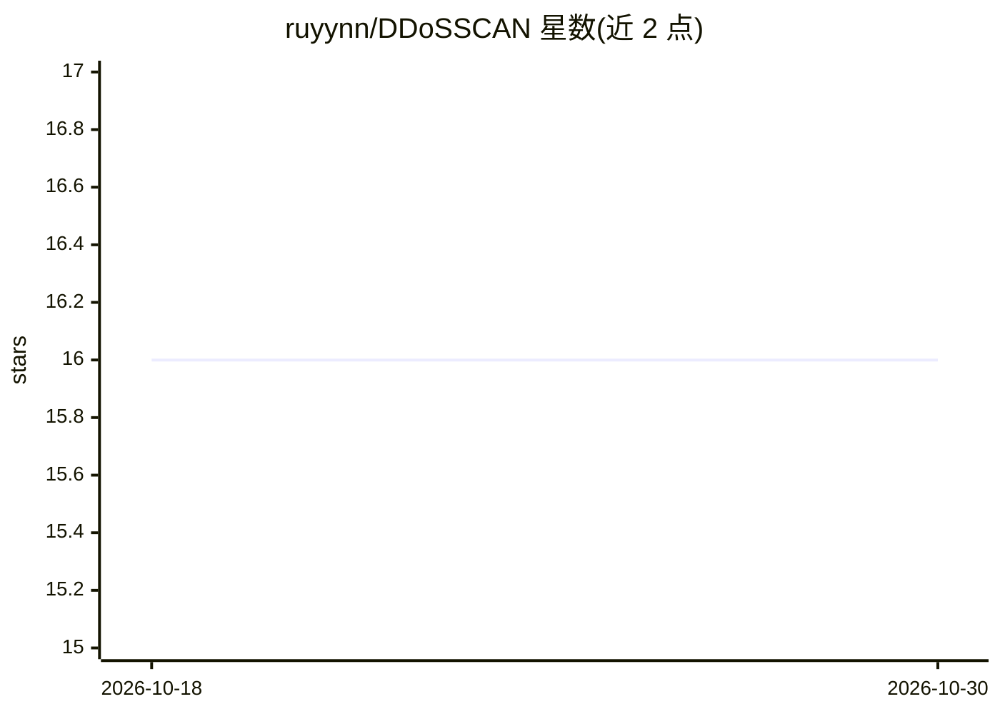

# ruyynn/DDoSSCAN

⭐ 16 · Python · GPL-3.0 · 推送 2026-03-31 · [GitHub](https://github.com/ruyynn/DDoSSCAN) · [官网](https://github.com/ruyynn/DDoSSCAN) · 个人维护

**面向授权测试的 Python 网络可用性与压力测试工具**

用 Python 编写的开源网络可用性与压力测试 CLI 工具，面向安全研究人员、网络工程师与系统管理员，在自有或获得授权的基础设施上测试韧性。提供 TCP/HTTP/UDP/Slowloris/混合多向量测试模式、基于带宽的参数计算、实时统计面板与 TXT/JSON 会话报告，并内置域名安全屏蔽系统（可配置 blocklist）阻止对政府/军事/关键基础设施域名的测试。跨 Linux/Windows/macOS/Termux 运行，README 以法律声明限定仅用于授权测试。

## 筛选速览

| 维度 | 判定 | 备注 |
|---|---|---|
| AI 角色 | `ai-ecosystem` | LLM/agent 周边工具 |
| 许可风险 | `viral` | GPL-3.0 |
| 部署形态 | `library` | 以包/库形式分发 |
| 模型依赖 | — | README 未给出锁定关系 |
| 硬件要求 | — | 无带数字的原话,不猜 |
| 安装摩擦 | `low` | 无编译、无系统依赖或容器化 |
| 成熟度 | — | 结构信号不足 |

## 能力要点

- TCP/HTTP/UDP/Slowloris/混合多向量压力测试
- 内置域名安全屏蔽系统（config/blocked_domains.json 可配置）
- 基于可用带宽的智能参数计算
- 实时统计面板与 TXT/JSON 会话报告生成

## 适用场景

- 在自有测试环境中评估网络与系统的抗压韧性
- 安全研究学习流量行为与系统可用性表现
- 网络容量规划场景下的受控压测

## 场景标签

`网络安全` · 领域:学习与行业

## 证据(README 行号)

> L38: _DDoSSCAN is an open-source **network availability and stress testing tool** written in Python. It is designed for 
> L55: |🧠 **Bandwidth Calculator**|AI-powered parameter optimization based on your network capacity|✅ **NEW**|

## 星数曲线

2026-10-18 16 → 2026-10-30 16（+0）

---
*卡片 v1 · prompt 1.4 · 生成 2026-10-30 · 置信度 low · 依据 README sha `3fb097eb057a` · [字段定义](../../DATASET.md)*
