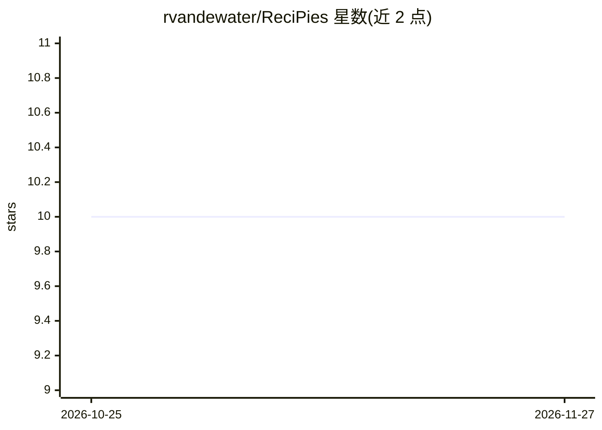

# rvandewater/ReciPies

⭐ 10 · Python · MIT · 推送 2026-01-14 · [GitHub](https://github.com/rvandewater/ReciPies) · [官网](https://rvandewater.github.io/ReciPies/) · 个人维护

**在 Polars/Pandas 上声明式定义可复现 ML 预处理步骤的 Python 库**

面向 Python 数据科学工作流的预处理管道库：将插补、编码、归一化等变换声明为有序步骤组成的 recipe，按语义角色（预测变量、结果、ID、时间戳）选择列，支持一次 prep 训练、多次 bake 应用，从构造上防止数据泄漏。底层同时支持 Polars 与 Pandas 后端并自动检测，步骤可注册扩展，recipe 可序列化为 JSON/YAML，pip/uv 安装。灵感来自 R 包 recipes，已有 JOSS 论文。

## 筛选速览

| 维度 | 判定 | 备注 |
|---|---|---|
| AI 角色 | `ai-enhanced` | 去掉 AI 部分产品仍成立 |
| 许可风险 | `permissive` | MIT |
| 部署形态 | `library` | 以包/库形式分发 |
| 模型依赖 | — | README 未给出锁定关系 |
| 硬件要求 | — | 无带数字的原话,不猜 |
| 安装摩擦 | `low` | 无编译、无系统依赖或容器化 |
| 成熟度 | — | 结构信号不足 |

## 能力要点

- 声明式 recipe：有序步骤 + 列语义角色（Ingredients/Recipe/Step/Selector 四个构建块）
- prep/bake 分离训练与新数据，构造上防止数据泄漏
- 同时支持 Polars 与 Pandas 后端并自动检测
- recipe 可序列化为 JSON/YAML，支持注册自定义步骤

## 适用场景

- 为机器学习管道定义可复现、可审计的预处理流程
- 团队协作中共享与评审特征工程步骤
- 论文发表时追踪并公开预处理的方法学细节

## 场景标签

`MLOps` · 领域:训练与推理

## 证据(README 行号)

> L6:  A declarative pipeline for reproducible ML preprocessing
> L25: construction. Under the hood, `ReciPies` targets both Pandas and Polars backends for performance and flexibility, a

## 星数曲线

2026-10-25 10 → 2026-11-27 10（+0）

---
*卡片 v1 · prompt 1.4 · 生成 2026-11-19 · 置信度 high · 依据 README sha `28c87caf60d4` · [字段定义](../../DATASET.md)*
