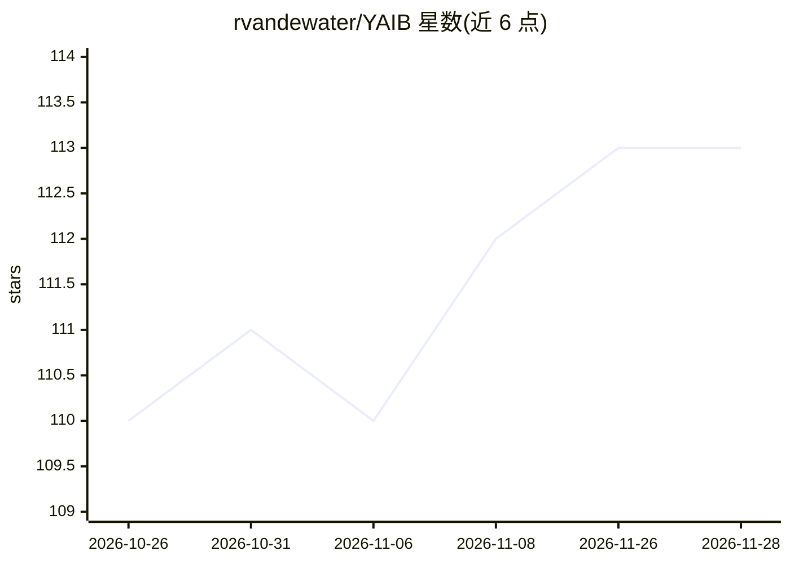

# rvandewater/YAIB

⭐ 113 · Python · MIT · 推送 2026-11-08 · [GitHub](https://github.com/rvandewater/YAIB) · [官网](http://www.rpvandewater.com/YAIB/) · 个人维护

**面向研究者的 ICU 临床预测实验标准化基准框架**

YAIB 是一个在 ICU 及其他 EHR 数据上开展临床机器学习实验的框架，内置 MIMIC-III/IV、eICU、HiRID、AUMCdb 四个数据集支持，默认提供 ICU 死亡率、急性肾损伤、脓毒症、肾功能、住院时长五类预测任务，并支持自定义数据集与任务。模型侧内置 LightGBM、LSTM、GRU、GRU-D 等多变量时序模型，基于 PyTorch/LightGBM/sklearn。以 Python CLI（icu-benchmarks）形式使用，需用 uv 从源码安装，并配合 ricu 生成队列、WandB 管理超参 sweep。

## 筛选速览

| 维度 | 判定 | 备注 |
|---|---|---|
| AI 角色 | `ai-ecosystem` | LLM/agent 周边工具 |
| 许可风险 | `permissive` | MIT |
| 部署形态 | `library` | 以包/库形式分发 |
| 模型依赖 | — | README 未给出锁定关系 |
| 硬件要求 | — | 无带数字的原话,不猜 |
| 安装摩擦 | `medium` | 含编译或系统依赖之一 |
| 成熟度 | — | 结构信号不足 |

## 能力要点

- 内置四个 ICU 数据集与五个临床预测任务，支持自定义扩展
- 内置 LightGBM/LSTM/GRU/GRU-D 等多变量时序模型
- CLI 支持训练、评估与微调，支持跨数据集评估
- 提供 demo 数据集，无需正式数据权限即可运行

## 适用场景

- 在多个 ICU 数据集上标准化复现临床预测实验
- 用自建 EHR 数据训练死亡率/脓毒症等预测模型
- 通过 WandB sweep 批量跑基准中的全部模型
- 教学场景下用公开 demo 数据学习临床 ML 流程

## 场景标签

`模型评测` `微调` · 领域:评测与运维

## 证据(README 行号)

> L16: Yet another ICU benchmark (YAIB) provides a framework for doing clinical machine learning experiments on Intensive 
> L32: We provide five common tasks for clinical prediction by default:
> L259: We provide several existing machine learning models that are commonly used for multivariate time-series data.

## 星数曲线

2026-10-26 110 → 2026-11-28 113（+3）

---
*卡片 v1 · prompt 1.4 · 生成 2026-11-28 · 置信度 mid · 依据 README sha `561e9dffbae5` · [字段定义](../../DATASET.md)*
