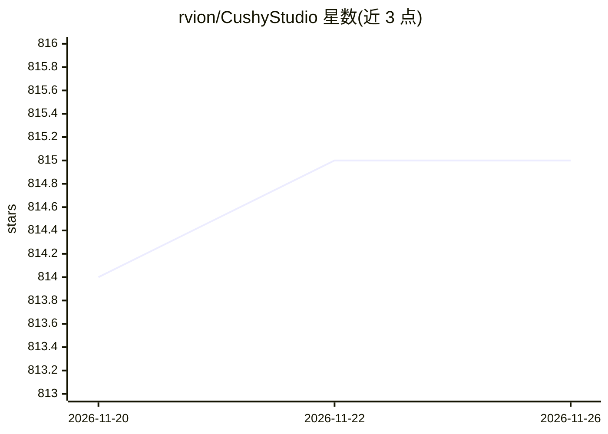

# rvion/CushyStudio

⭐ 815 · TypeScript · AGPL-3.0 · 推送 2026-11-19 · [GitHub](https://github.com/rvion/CushyStudio) · [官网](https://docs.cushystudio.com/) · 个人维护

**面向创作者的生成式 AI 平台：制作图像、视频与 3D**

CushyStudio 是一个生成式 AI 平台，面向不同水平的创作者，提供图像、视频和 3D 模型的生成能力。包含 CushyApps（面向艺术任务的视觉工具集）与 CushyKit（用于自定义应用开发与任务自动化的 TypeScript 工具包），可接入 ComfyUI 运行工作流，内置 CushyDiffusion、去背景、漫画上色等应用，支持统一画布的 inpainting/outpainting。项目已不再积极开发，部分功能可能与新版 ComfyUI 不兼容，新工作转移到 comfy-ts。

## 筛选速览

| 维度 | 判定 | 备注 |
|---|---|---|
| AI 角色 | `ai-native` | 本体是模型或模型工具 |
| 许可风险 | `viral` | AGPL-3.0 |
| 部署形态 | `None` |  |
| 模型依赖 | — | README 未给出锁定关系 |
| 硬件要求 | — | 无带数字的原话,不猜 |
| 安装摩擦 | `low` | 无编译、无系统依赖或容器化 |
| 成熟度 | — | 结构信号不足 |

## 能力要点

- CushyApps：面向不同艺术任务的视觉工具集
- CushyKit：预配置 TypeScript 环境，快速设计界面与自定义逻辑
- 接入 ComfyUI 工作流，支持从 ComfyUI 导入
- 内置 CushyDiffusion、统一画布、inpainting/outpainting 等应用

## 适用场景

- 用预配置工具生成图像、视频和 3D 模型
- 基于 TypeScript 开发自定义生成式应用
- 通过可视化界面运行 ComfyUI 工作流

## 场景标签

`图像生成` `视频生成` · 领域:内容生成

## 证据(README 行号)

> L27: **CushyStudio** is the go-to platform for easy generative AI use, empowering creatives of any level to effortlessly
> L31: * **CushyApps**: A collection of visual tools tailored for different artistic tasks. Simplify your AI art creation 
> L38: > CushyStudio is no longer under active development. The code stays here as it is, and some of it may not work with

## 星数曲线

2026-11-20 814 → 2026-11-26 815（+1）

---
*卡片 v1 · prompt 1.4 · 生成 2026-11-20 · 置信度 high · 依据 README sha `25e397f576f0` · [字段定义](../../DATASET.md)*
