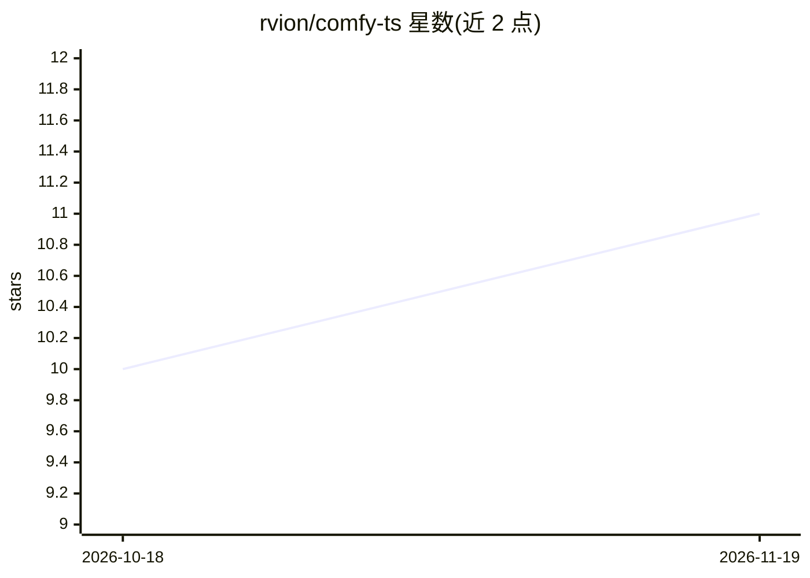

# rvion/comfy-ts

⭐ 11 · TypeScript · MIT · 推送 2026-11-18 · [GitHub](https://github.com/rvion/comfy-ts) · 个人维护

**给 TypeScript 开发者的 ComfyUI 类型安全 SDK 与 CLI 工具包**

comfy-ts 提供 TypeScript 编写和运行 ComfyUI 工作流的完整工具链：SDK、代码生成器、CLI、TUI 与 Web 面板。类型从用户自己的 ComfyUI 主机生成（sdk.d.ts），错误的工作流图在编译期报错，checkpoint/sampler 等输入为字面量联合类型。支持本地 GPU、远程机器与 Comfy Cloud 运行，输出以 WebSocket 流回代码或按需落盘。运行需已有 ComfyUI 实例，运行环境为 Bun 或 Node ≥ 20，双 ESM/CJS。

## 筛选速览

| 维度 | 判定 | 备注 |
|---|---|---|
| AI 角色 | `ai-ecosystem` | LLM/agent 周边工具 |
| 许可风险 | `permissive` | MIT |
| 部署形态 | `library` | 以包/库形式分发 |
| 模型依赖 | — | README 未给出锁定关系 |
| 硬件要求 | — | 无带数字的原话,不猜 |
| 安装摩擦 | `low` | 无编译、无系统依赖或容器化 |
| 成熟度 | — | 结构信号不足 |

## 能力要点

- codegen 读取用户自己的 ComfyUI 主机，生成含字面量类型的 SDK
- 非法工作流图在编译期报错，问题累积在 workflow.problems
- CLI/TUI/Web 面板/HTTP serve 多种运行入口，支持 AI agent 调用 CLI
- SaveImageWebsocket 一等公民支持，ephemeral 模式不留服务器磁盘痕迹

## 适用场景

- 用 TypeScript 代码构建和管理 ComfyUI 图像/视频/音频生成工作流
- 为团队把 ComfyUI 工作流封装成带表单参数的应用
- 让 AI agent 通过 CLI 生成内容
- 将 ComfyUI 工作流通过 HTTP 接入前端或 n8n

## 场景标签

`代码生成` `图像生成` · 领域:编码与开发

## 证据(README 行号)

> L3: **Write ComfyUI workflows in TypeScript, then run them from code, one command, a terminal, a browser or an agent.**
> L7: Types come from your own ComfyUI: every node and model it has autocompletes, and a wrong graph is a compile error. R
> L123: This is not a ComfyUI type package that someone published once. One command reads YOUR host and writes a full SDK 

## 星数曲线

2026-10-18 10 → 2026-11-19 11（+1）

---
*卡片 v1 · prompt 1.4 · 生成 2026-11-19 · 置信度 high · 依据 README sha `a7e37c9a88cc` · [字段定义](../../DATASET.md)*
