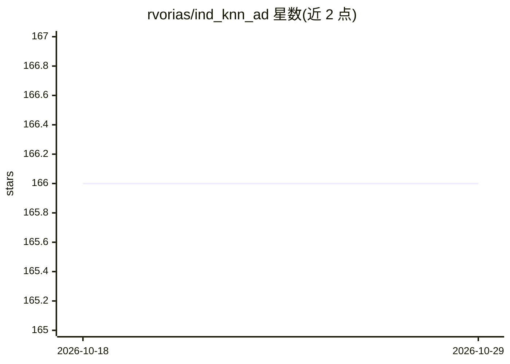

# rvorias/ind_knn_ad

⭐ 166 · Python · MIT · 推送 2026-09-05 · [GitHub](https://github.com/rvorias/ind_knn_ad) · [官网](https://share.streamlit.io/rvorias/ind_knn_ad) · 个人维护

**工业图像异常检测工具：kNN 基线模型与数据集操作台**

基于 PyTorch 与 timm 的工业图像异常检测库，实现 SPADE、PaDiM、PatchCore 三种基线，输出图像级与像素级检测结果；提供 MVTec 兼容数据集的创建、导入、就绪检查与样本审查流程，配套 FastAPI 浏览器操作台（indad-web）与 CLI，可将检查结果导出为 JSON 供 agent 使用。要求 Python 3.10+，支持 GPU 或确定性 CPU 执行，附 MVTec AD 上的复现指标。

## 筛选速览

| 维度 | 判定 | 备注 |
|---|---|---|
| AI 角色 | `ai-native` | 本体是模型或模型工具 |
| 许可风险 | `permissive` | MIT |
| 部署形态 | `library` | 以包/库形式分发 |
| 模型依赖 | — | README 未给出锁定关系 |
| 硬件要求 | — | 无带数字的原话,不猜 |
| 安装摩擦 | `low` | 无编译、无系统依赖或容器化 |
| 成熟度 | — | 结构信号不足 |

## 能力要点

- SPADE/PaDiM/PatchCore 三种异常检测基线
- 数据集工作流：创建→导入→检查→审查→训练基线
- FastAPI 操作台（样本画廊、掩码审查、质量检查）与 HTTP API/OpenAPI
- indad-data 导出 JSON manifest 供 agent 使用

## 适用场景

- 在 MVTec 数据集或自建工业图像上运行异常检测基线
- 操作员构建与审查带掩码标注的异常检测数据集
- 复现论文指标并按类别查看图像级/像素级结果

## 场景标签

`目标检测` · 领域:感知与多模态

## 证据(README 行号)

> L29: Three core anomaly detection baselines support this workflow:
> L31: 1. SPADE (Cohen et al. 2021) - knn in z-space and distance to feature maps
> L35: 3. PatchCore (Roth et al. 2021) - knn distance to avgpooled feature maps

## 星数曲线

2026-10-18 166 → 2026-10-29 166（+0）

---
*卡片 v1 · prompt 1.4 · 生成 2026-10-22 · 置信度 high · 依据 README sha `44a731343b74` · [字段定义](../../DATASET.md)*
