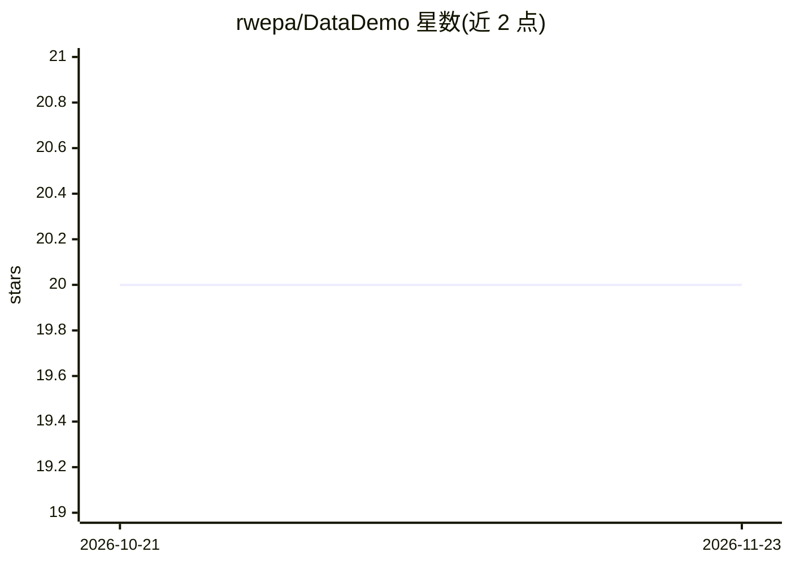

# rwepa/DataDemo

⭐ 20 · Jupyter Notebook · 推送 2026-09-01 · [GitHub](https://github.com/rwepa/DataDemo) · 个人维护 · 中文 README

**数据科学与机器学习教学用数据集与范例集合**

由 rwepa 维护的数据集分享仓库，收录数十个来自开放数据（Kaggle、UCI、台湾政府开放数据、美国 EPA）或模拟生成的 CSV/Excel/SAS/ARFF 格式数据集，涵盖房价、信用风险、客户流失、医疗健康、空气质量、人力资源、金融投资等领域。README 逐条列出每个数据集的来源、笔数、栏位个数与栏位中英文说明，部分条目附 R 语言导出代码与参考书籍链接，供数据科学与机器学习教学与练习使用。

## 筛选速览

| 维度 | 判定 | 备注 |
|---|---|---|
| AI 角色 | `ai-knowledge` | 知识聚合/清单类 |
| 许可风险 | `none` | — |
| 部署形态 | `desktop` | 安装包/桌面程序 |
| 模型依赖 | — | README 未给出锁定关系 |
| 硬件要求 | — | 无带数字的原话,不猜 |
| 安装摩擦 | `low` | 无编译、无系统依赖或容器化 |
| 成熟度 | — | 结构信号不足 |

## 能力要点

- 数十个跨领域数据集，附笔数与逐栏位中英文说明
- 数据来源涵盖 Kaggle、UCI、data.gov.tw、美国 EPA 与模拟数据
- 部分条目附 R 语言（MASS、fpp、readr）数据导出与读取代码
- 含大型数据集（如 936 万笔臭氧小时数据、11.2GB 航班数据）

## 适用场景

- 数据科学课程练习中寻找带完整栏位说明的练习数据集
- 机器学习建模（分类/回归/时间序列）寻找现成数据
- 教学演示回归、客户流失预测、时间序列分析等案例

## 场景标签

 · 领域:数据科学/教学资源

## 证据(README 行号)

> L1: # 資料集與使用範例
> L2: 提供資料集與範例分享, 資料集來自於 Open data或模擬資料.

## 星数曲线

2026-10-21 20 → 2026-11-23 20（+0）

---
*卡片 v1 · prompt 1.4 · 生成 2026-11-18 · 置信度 high · 依据 README sha `4630644c2fbc` · [字段定义](../../DATASET.md)*
