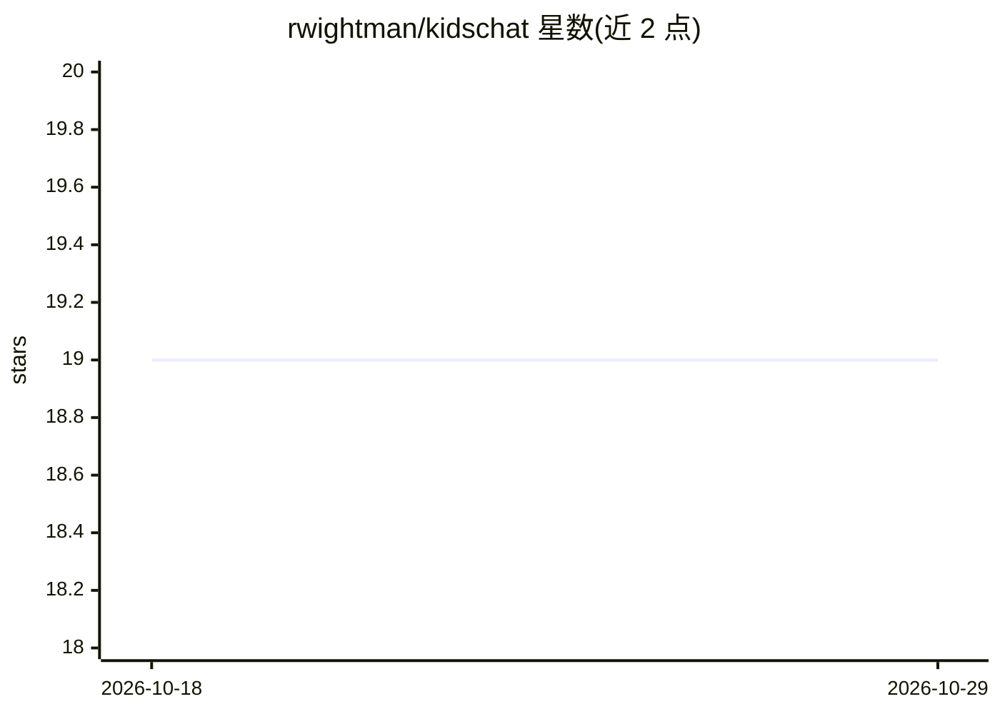

# rwightman/kidschat

⭐ 19 · Python · Apache-2.0 · 推送 2026-04-14 · [GitHub](https://github.com/rwightman/kidschat) · 个人维护

**面向儿童的本地优先 AI 语音对话演示应用**

本地优先的原型 Web 应用，用于在有成人陪同的场景下向儿童演示 AI：浏览器聊天界面、按键说话语音输入、faster-whisper 本地语音转文字、Ollama 本地模型生成回答，可选配置 Claude/OpenAI/Gemini API key 作为云端升级路径。前端用 Three.js 渲染会说话的头像并配合 HeadTTS/Piper 语音输出，支持拍照向视觉模型提问。内置图片/声音搜索、笑话、天气、数学、Mermaid 图表与 SVG 画图等工具调用。README 明确声明这是未经安全评审的原型，不构成儿童安全或辅导产品，需成人监督使用。

## 筛选速览

| 维度 | 判定 | 备注 |
|---|---|---|
| AI 角色 | `ai-native` | 本体是模型或模型工具 |
| 许可风险 | `permissive` | Apache-2.0 |
| 部署形态 | `library` | 以包/库形式分发 |
| 模型依赖 | local-ok | 支持本地模型 |
| 硬件要求 | — | 无带数字的原话,不猜 |
| 安装摩擦 | `low` | 无编译、无系统依赖或容器化 |
| 成熟度 | `idea` | |

## 能力要点

- Ollama 本地模型优先，可选 Claude/OpenAI/Gemini 云端升级
- faster-whisper 本地 STT 与 Piper/say/HeadTTS 多级 TTS 回退
- 浏览器端 Three.js 会说话头像（TalkingHead）
- 8 种工具调用：图片/声音搜索、笑话、天气、数学、图表、SVG 画图等

## 适用场景

- 在有成人陪同下向儿童趣味演示 AI 对话能力
- 通过语音与头像进行儿童友好的问答互动
- 拍摄照片让本地视觉模型描述场景

## 场景标签

`语音 Agent` · 领域:对话与助手

## 证据(README 行号)

> L3: KidsChat is a local-first prototype web app for demonstrating AI to children in a playful, voice-friendly way. It co
> L20: - Local LLM responses through Ollama
> L67: 4. The orchestrator sends the conversation to a local Ollama model first.

## 星数曲线

2026-10-18 19 → 2026-10-29 19（+0）

---
*卡片 v1 · prompt 1.4 · 生成 2026-10-28 · 置信度 high · 依据 README sha `384a22db8e89` · [字段定义](../../DATASET.md)*
