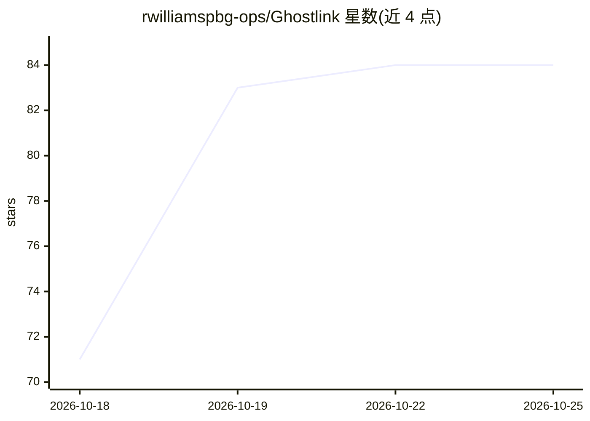

# rwilliamspbg-ops/Ghostlink

⭐ 84 · Rust · MIT · 推送 2026-10-24 · [GitHub](https://github.com/rwilliamspbg-ops/Ghostlink) · [官网](https://rwilliamspbg-ops.github.io/Ghostlink/) · 个人维护

**面向本地异构集群的分布式 LLM 推理架构，提供 OpenAI 兼容 API**

Rust 编写的自托管分布式推理架构：在局域网内自动发现节点，通过 llama.cpp 的 ggml-rpc 后端切分 GGUF 模型权重，跨 CPU/GPU/NPU 混合硬件做感知式调度，并对外提供 OpenAI 兼容的 /v1/chat/completions API 与 React GUI（Ghostlink Studio）。后端可在原生 llama-server 与 Ollama 之间切换。启动器提供零配置的集群组建，自动探测 CUDA/DirectML/ROCm/Vulkan/Metal/NPU 加速器。注意：零拷贝 SPSC 环形缓冲与 AF_XDP 内核旁路为实验性研究组件，实际推理不走该通路；预编译二进制仅限 x86_64。

## 筛选速览

| 维度 | 判定 | 备注 |
|---|---|---|
| AI 角色 | `ai-ecosystem` | LLM/agent 周边工具 |
| 许可风险 | `permissive` | MIT |
| 部署形态 | `self-host` | docker 或自建部署 |
| 模型依赖 | local-ok | 支持本地模型 |
| 硬件要求 | — | 无带数字的原话,不猜 |
| 安装摩擦 | `low` | 无编译、无系统依赖或容器化 |
| 成熟度 | `idea` | |

## 能力要点

- 局域网零配置节点发现，跨 CPU/GPU/NPU 分布式推理（基于 ggml-rpc 切分 GGUF 权重）
- OpenAI 兼容 /v1/chat/completions API 服务器与浏览器 GUI
- 自动硬件探测：CUDA/DirectML/ROCm/Vulkan/Metal/NPU 多路径探测
- 推理后端可在原生 llama-server 与 Ollama 间切换

## 适用场景

- 把家里多台新旧设备（游戏显卡 + 旧笔记本 + NPU 超极本 + Mac）组成一个推理集群
- 自托管 OpenAI 兼容 API 服务，避免供应商锁定
- 在混合硬件局域网内运行本地 GGUF 模型并对话

## 场景标签

`推理引擎` · 领域:训练与推理

## 证据(README 行号)

> L34: Discover LAN peers → Split GGUF model weights via `ggml-rpc` → Serve OpenAI-compatible `/v1/chat/completions`.
> L38: - OpenAI-compatible `/v1/chat/completions` API server.

## 星数曲线

2026-10-18 71 → 2026-10-25 84（+13）

---
*卡片 v1 · prompt 1.4 · 生成 2026-10-24 · 置信度 high · 依据 README sha `9a3602805804` · [字段定义](../../DATASET.md)*
