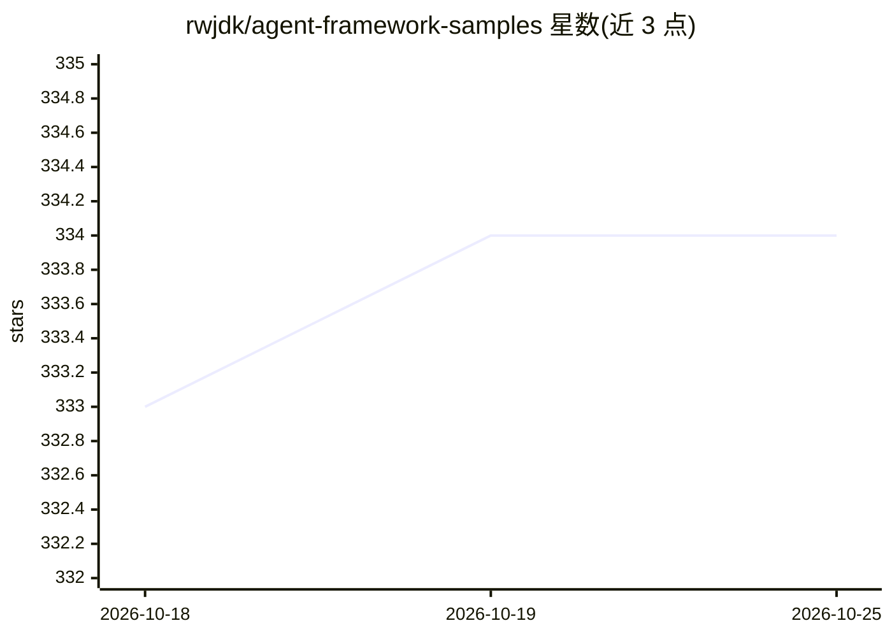

# rwjdk/agent-framework-samples

⭐ 334 · C# · MIT · 推送 2026-10-23 · [GitHub](https://github.com/rwjdk/agent-framework-samples) · [官网](https://youtube.com/playlist?list=PLhGl0l5La4sYXjYOBv7h9l7x6qNuW34Cx) · 个人维护

**微软 Agent Framework 的 C# 示例代码集**

演示 Microsoft Agent Framework 在 C# 中用法的示例仓库。Agent Framework 是微软开源的生成式 AI 多智能体应用构建框架，定位为 Semantic Kernel 与 AutoGen 的后继者，支持 C# 与 Python（本仓库仅覆盖 C#）。仓库配套 Udemy 课程与 YouTube 视频系列讲解各示例，其中一个端到端示例（Comic Book E2E）已迁移至独立仓库维护。

## 筛选速览

| 维度 | 判定 | 备注 |
|---|---|---|
| AI 角色 | `ai-knowledge` | 知识聚合/清单类 |
| 许可风险 | `permissive` | MIT |
| 部署形态 | `None` |  |
| 模型依赖 | — | README 未给出锁定关系 |
| 硬件要求 | — | 无带数字的原话,不猜 |
| 安装摩擦 | `low` | 无编译、无系统依赖或容器化 |
| 成熟度 | — | 结构信号不足 |

## 能力要点

- 以 C# 示例演示 Microsoft Agent Framework
- 框架为 Semantic Kernel 与 AutoGen 的后继者，支持 C# 与 Python
- 示例与 Udemy 课程及 YouTube 视频系列配套

## 适用场景

- 跟随视频课程学习 Agent Framework 的 C# 用法
- 参考示例代码构建多智能体应用
- 了解 Semantic Kernel/AutoGen 之后微软的新框架方向

## 场景标签

`Agent 框架` `多智能体` `教程课程` · 领域:Agent 开发

## 证据(README 行号)

> L3: Samples demonstrating the Microsoft Agent Framework in C#
> L6: AF is the successor of Semantic Kernel and AutoGen; two Generative AI Frameworks from Microsoft for building Multi-a

## 星数曲线

2026-10-18 333 → 2026-10-25 334（+1）

---
*卡片 v1 · prompt 1.4 · 生成 2026-10-21 · 置信度 mid · 依据 README sha `e054ea6887ca` · [字段定义](../../DATASET.md)*
