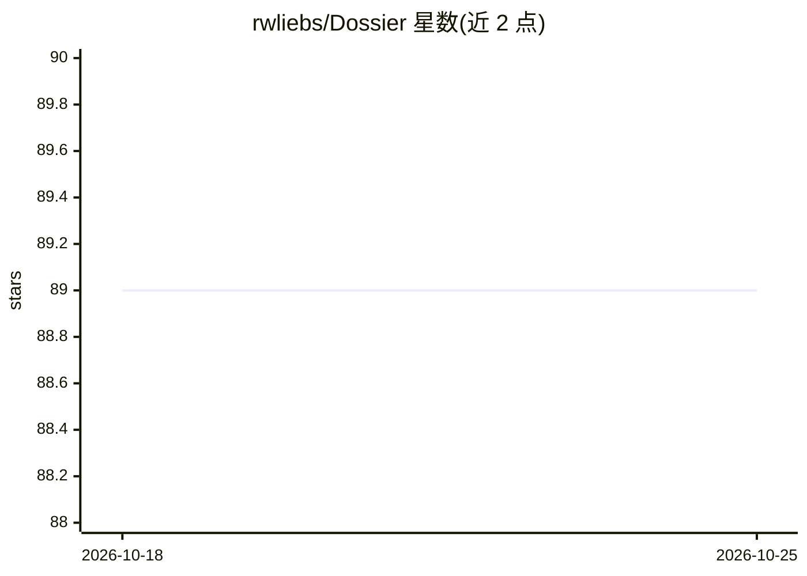

# rwliebs/Dossier

⭐ 89 · TypeScript · NOASSERTION · 推送 2026-07-15 · [GitHub](https://github.com/rwliebs/Dossier) · [官网](http://www.dossierbuilds.app) · 个人维护

**AI 编码产品的可视化规划与上下文管理平台**

面向用 AI agent 构建较大规模应用的开发者的本地优先平台：将产品组织为 Project→Workflow→Feature card 层级地图，每张卡持有需求、事实、假设、测试与代码文件等上下文；调度 agent 时按卡精确投喂上下文。构建编排基于 Claude Agent SDK 在进程内执行，每卡每运行建独立 Git 特性分支，可自动提交并一键推分支。可连接 GitHub 仓库做映射，产品与运行状态存 SQLite，嵌入存 RuVector，无云端依赖（除 Anthropic/GitHub 连接）。技术栈为 Next.js/React/TypeScript，需 Node 20+ 与 Anthropic API key，Windows 安装需 C++ 编译工具。许可为 PolyForm Shield 1.0.0。

## 筛选速览

| 维度 | 判定 | 备注 |
|---|---|---|
| AI 角色 | `ai-ecosystem` | LLM/agent 周边工具 |
| 许可风险 | `none` | NOASSERTION |
| 部署形态 | `library` | 以包/库形式分发 |
| 模型依赖 | locked-api |  |
| 硬件要求 | — | 无带数字的原话,不猜 |
| 安装摩擦 | `low` | 无编译、无系统依赖或容器化 |
| 成熟度 | — | 结构信号不足 |

## 能力要点

- Product→Workflow→Feature card 层级地图与逐卡上下文卡片
- 基于 Claude Agent SDK 的进程内构建编排，每卡独立特性分支
- 规划 agent 可从已连接仓库与 README 推断工作流并生成地图
- 本地优先：SQLite + RuVector 向量库，数据不出本机

## 适用场景

- 把已有仓库映射为结构化产品地图再让 agent 开发
- 逐卡审批后触发 agent 构建、自动提交并推送特性分支
- 管理多工作流产品的需求与上下文文档，避免跨会话丢失

## 场景标签

`编码 Agent` `知识库管理` · 领域:编码与开发

## 证据(README 行号)

> L94: |**Build agents**|`@anthropic-ai/claude-agent-sdk` `query()` (in-process); agent definitions from agentic-flow|
> L152: - **Build orchestration:** Trigger builds per card or workflow; one feature branch per card per run; in-process Cl

## 星数曲线

2026-10-18 89 → 2026-10-25 89（+0）

---
*卡片 v1 · prompt 1.4 · 生成 2026-10-23 · 置信度 high · 依据 README sha `63fad4db34ee` · [字段定义](../../DATASET.md)*
