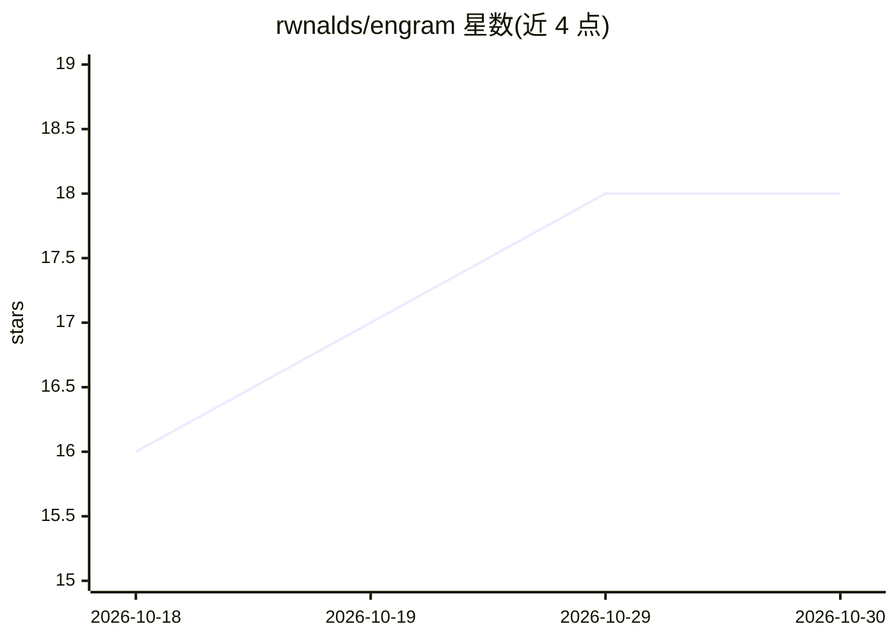

# rwnalds/engram

⭐ 18 · TypeScript · MIT · 推送 2026-08-14 · [GitHub](https://github.com/rwnalds/engram) · 个人维护

**自托管 MCP 记忆服务器：让多个 AI agent 共享读写 git 化 markdown 库**

自托管的 MCP 服务器 + Web 仪表盘，供 Claude Code、Cursor、Codex、Hermes 及任意 MCP 客户端对同一个 git 管理的 markdown 目录进行共享长期记忆的读写。核心机制：基于 frontmatter 的 authority 排序与 superseded_by/valid_until 时效标记，检索时默认扣留过期笔记并返回 excluded 原因清单；写入时拒绝矛盾写入；git 记录每笔写归属并提供 per-agent 读写 token。无数据库，文件即真相，内置 MiniSearch 全文索引与 wikilink 图。以 Docker 镜像（HTTP 与 stdio 两种）或 bun 源码运行，需持久卷，不支持 serverless。

## 筛选速览

| 维度 | 判定 | 备注 |
|---|---|---|
| AI 角色 | `ai-ecosystem` | LLM/agent 周边工具 |
| 许可风险 | `permissive` | MIT |
| 部署形态 | `self-host` | docker 或自建部署 |
| 模型依赖 | — | README 未给出锁定关系 |
| 硬件要求 | — | 无带数字的原话,不猜 |
| 安装摩擦 | `low` | 无编译、无系统依赖或容器化 |
| 成熟度 | — | 结构信号不足 |

## 能力要点

- 15 个 brain_* MCP 工具，单 bearer 认证 HTTP 端点接入任意 MCP 客户端
- superseded_by/valid_until 时效标记 + authority 排序，检索默认扣留过期笔记并给出原因
- 写入时矛盾拒绝与 brain_supersede 原子替换；git 审计 + per-agent 读写 token
- 兼容 Obsidian vault，无数据库，可选 Curator agent 整理笔记

## 适用场景

- 团队让多个 agent 并发读写同一个知识库作为共享记忆
- 给 Claude Code 等编码 agent 提供跨会话项目记忆
- 让 agent 不再引用已作废的价格或旧版 API 文档

## 场景标签

`Agent 记忆` · 领域:Agent 开发

## 证据(README 行号)

> L17: Engram is a self-hosted **MCP server + dashboard** that gives Claude Code, Cursor, Hermes, and any
> L96: - **MCP server** — 15 `brain_*` tools over one bearer-authenticated HTTP endpoint (`POST /api/mcp`,
> L143: Any client that speaks the **Model Context Protocol** — one endpoint, bearer-token auth. Most-used first:

## 星数曲线

2026-10-18 16 → 2026-10-30 18（+2）

---
*卡片 v1 · prompt 1.4 · 生成 2026-10-29 · 置信度 high · 依据 README sha `808be1aff145` · [字段定义](../../DATASET.md)*
