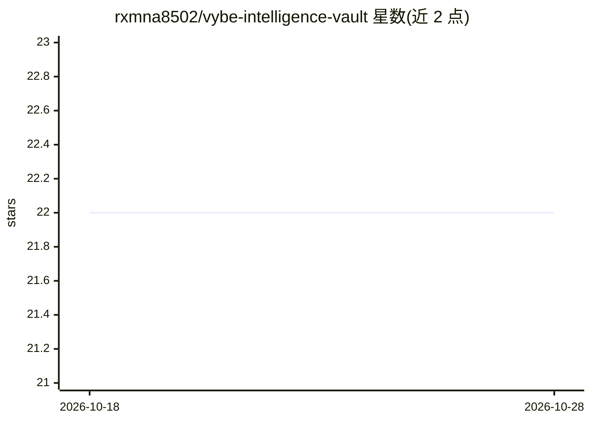

# rxmna8502/vybe-intelligence-vault

⭐ 22 · NOASSERTION · 推送 2026-10-28 · [GitHub](https://github.com/rxmna8502/vybe-intelligence-vault) · [官网](https://rxmna8502.github.io/vybe-intelligence-vault/) · 个人维护

**自动更新的 AI 工程知识库，供 MCP agent 查询 16 万+ 节点**

自称为自主演化、自动采集的知识仓库：通过采集管线监控 ArXiv、HuggingFace、GitHub 等来源，抽取 AI Agents、RAG、MCP、推理运维等类别的知识节点，构建语义向量图并以 160,000+ 节点形式发布。面向 AI 编码助手与 agent 运行时提供 FastMCP 网关（HTTP :3456 / stdio），支持 Claude Desktop、Cursor 等接入；另含 React 19 + R3F 的 3D 可视化界面、8 个 7 天冲刺蓝图与 6 个生产栈目录。安装方式为 git clone 后运行 Node 脚本重建索引。

## 筛选速览

| 维度 | 判定 | 备注 |
|---|---|---|
| AI 角色 | `ai-knowledge` | 知识聚合/清单类 |
| 许可风险 | `none` | NOASSERTION |
| 部署形态 | `library` | 以包/库形式分发 |
| 模型依赖 | — | README 未给出锁定关系 |
| 硬件要求 | — | 无带数字的原话,不猜 |
| 安装摩擦 | `low` | 无编译、无系统依赖或容器化 |
| 成熟度 | — | 结构信号不足 |

## 能力要点

- FastMCP 网关（HTTP :3456 / stdio）供 Claude Desktop、Cursor 等 agent 查询节点
- 自动采集管线监控 ArXiv/HuggingFace/GitHub 并发布知识节点
- React Three Fiber 3D 知识图谱可视化（Cmd+K 搜索 160,000+ 节点）
- 8 个 7 天冲刺蓝图与 6 个生产栈目录

## 适用场景

- 为 Claude Desktop / Cursor 等 MCP 客户端接入 AI 工程知识查询
- 浏览 AI Agents/RAG/MCP/推理领域的索引节点与每日摘要
- 按蓝图目录规划 7 天学习或构建冲刺

## 场景标签

`知识图谱` `精选清单` `语义搜索` · 领域:知识与检索

## 证据(README 行号)

> L4:  A living, self-synthesizing intelligence repository indexing the frontier of AI Agents, RAG Architectures, MCP Tool
> L26: Powered by a distributed harvesting mesh and multi-model LLM evaluators, the vault continuously monitors global AI 
> L43: The vault is built from the ground up for the **Model Context Protocol (MCP)**. Your AI coding assistants (Claude D

## 星数曲线

2026-10-18 22 → 2026-10-28 22（+0）

---
*卡片 v1 · prompt 1.4 · 生成 2026-10-27 · 置信度 mid · 依据 README sha `837d769ecbd5` · [字段定义](../../DATASET.md)*
