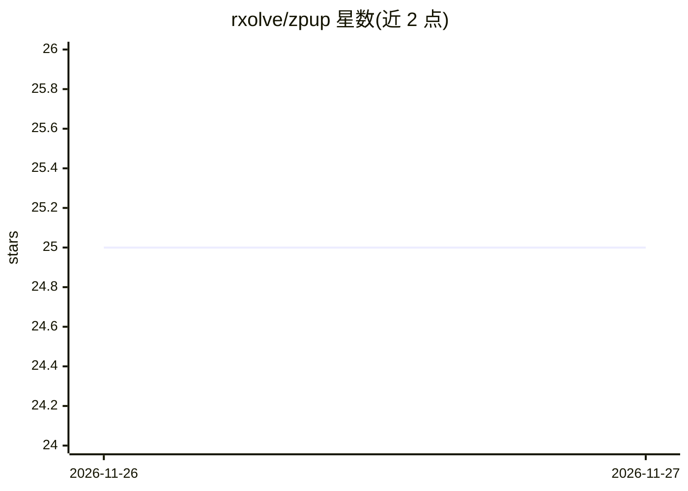

# rxolve/zpup

⭐ 25 · HTML · MIT · 推送 2026-11-25 · [GitHub](https://github.com/rxolve/zpup) · [官网](https://rxolve.github.io/zpup/) · 个人维护

**用 JSON 描述小型 3D 场景并渲染为平面 SVG 的库**

TypeScript 编写的伪 3D 场景渲染库：接收纯对象/JSON 描述的场景（box、cylinder、cone 等实体与平面形状），自动做逐对深度排序与面向着色，从任意视角输出无 JavaScript 的 SVG；支持 SMIL 常速旋转动画与 sprite sheet 式多方向出图。提供 @zpup/core 库、JSON 编辑 playground、附带 MCP server 供模型写入并校验场景。声明 1.0 稳定格式；无透视、纹理、光照，深度互相切入的形状不能正确绘制。

## 筛选速览

| 维度 | 判定 | 备注 |
|---|---|---|
| AI 角色 | `ai-enhanced` | 去掉 AI 部分产品仍成立 |
| 许可风险 | `permissive` | MIT |
| 部署形态 | `library` | 以包/库形式分发 |
| 模型依赖 | — | README 未给出锁定关系 |
| 硬件要求 | — | 无带数字的原话,不猜 |
| 安装摩擦 | `low` | 无编译、无系统依赖或容器化 |
| 成熟度 | — | 结构信号不足 |

## 能力要点

- 逐对深度排序与面向着色，输出无 JS 的纯 SVG（灯塔单视图 5.5 KB）
- 同一场景改 rotate 即得任意视角，可批量生成游戏 sprite sheet
- renderSpinSvg 用 SMIL 输出常速旋转动画，无需 JavaScript
- 校验错误 ZpupValidationError 列出每条问题及其路径与修复方式

## 适用场景

- 为图标、吉祥物、小建筑生成有体积感的插图
- 为游戏一次性生成角色各方向各姿态的精灵图
- 让 AI 模型通过 MCP 写场景、看图并迭代修正
- 在邮件或 README 中嵌入可旋转的小型插画

## 场景标签

`代码生成` · 领域:编码与开发

## 证据(README 行号)

> L3: Describe a small 3D scene as JSON and get a flat SVG picture of it from any angle. Inspired by Zdog.
> L15: **Use it from an AI model**: an MCP server lets Claude and other models write a scene, look at the picture and corr
> L37: It is not a 3D engine. There is no perspective, no textures and no light to place, and shapes that cut deep into ea

## 星数曲线

2026-11-26 25 → 2026-11-27 25（+0）

---
*卡片 v1 · prompt 1.4 · 生成 2026-11-26 · 置信度 high · 依据 README sha `798d38a769d8` · [字段定义](../../DATASET.md)*
