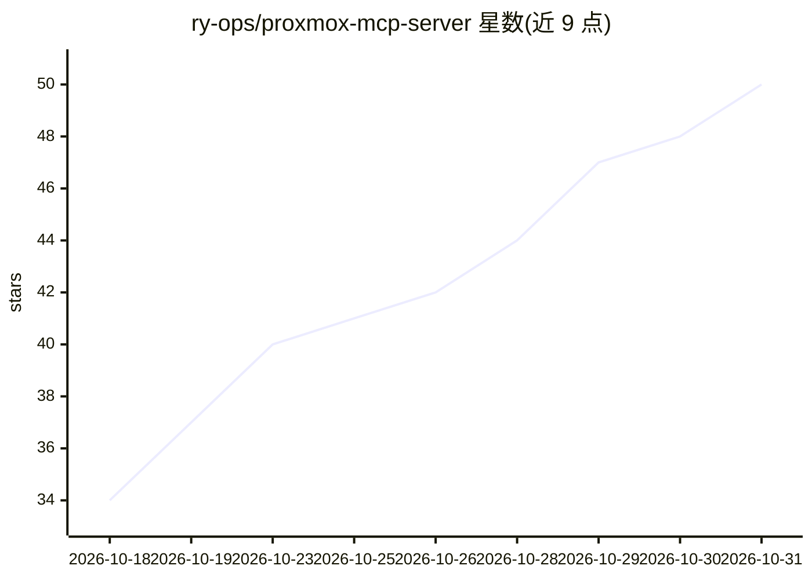

# ry-ops/proxmox-mcp-server

⭐ 50 · Python · MIT · 推送 2026-10-30 · [GitHub](https://github.com/ry-ops/proxmox-mcp-server) · 个人维护

**通过 MCP 让 AI 客户端管理 Proxmox 虚拟化集群的服务器**

Python 编写的 Model Context Protocol 服务器，把 Proxmox VE REST API 暴露为 340 个工具，覆盖 14 个领域：QEMU 虚拟机、LXC 容器、节点、存储与备份、集群与 HA、访问控制、防火墙、Ceph、ACME、SDN、通知、磁盘、资源池与设备部署。MCP 客户端经 stdio 启动并调用，服务器以 API token 或密码通过 HTTPS 端口 8006 访问 Proxmox。提供只读模式（拒绝所有写请求，149 个只读工具可用）、QEMU guest agent 内执行命令、FortiGate-VM 与云镜像批量部署、agent-card.json 的 A2A 能力清单。可用 uv 从源码运行或拉取 ghcr.io 多架构 Docker 镜像。

## 筛选速览

| 维度 | 判定 | 备注 |
|---|---|---|
| AI 角色 | `ai-ecosystem` | LLM/agent 周边工具 |
| 许可风险 | `permissive` | MIT |
| 部署形态 | `self-host` | docker 或自建部署 |
| 模型依赖 | — | README 未给出锁定关系 |
| 硬件要求 | — | 无带数字的原话,不猜 |
| 安装摩擦 | `low` | 无编译、无系统依赖或容器化 |
| 成熟度 | — | 结构信号不足 |

## 能力要点

- 340 个工具覆盖 Proxmox API 的 14 个领域
- PROXMOX_READ_ONLY 只读模式在服务器端拒绝写请求，149 个只读工具可用
- QEMU guest agent 在虚拟机内执行命令并回读输出
- agent-card.json 列出全部工具供 agent 间发现与调用

## 适用场景

- 用对话让 AI 客户端管理 Proxmox 集群的虚拟机与容器
- 通过 guest agent 在虚拟机内远程执行命令
- 配合只读模式和 PVEAuditor 角色做监控型接入
- 批量部署云镜像虚拟机（含 SSH key 与静态 IP）供 K3s 集群使用

## 场景标签

 · 领域:基础设施/虚拟化管理

## 证据(README 行号)

> L10:  Talk to your Proxmox cluster. A Model Context Protocol server that gives Claude, or any MCP client, the whole Prox
> L51: - **Your MCP client** (Claude Desktop, Claude Code, or anything that speaks MCP) starts the server and talks to it 
> L52: - **The server** (Python, `httpx`, the MCP SDK) turns each tool call into a request to the **Proxmox VE REST API** 

## 星数曲线

2026-10-18 34 → 2026-10-31 50（+16）

---
*卡片 v1 · prompt 1.4 · 生成 2026-10-25 · 置信度 high · 依据 README sha `795024e8bd31` · [字段定义](../../DATASET.md)*
