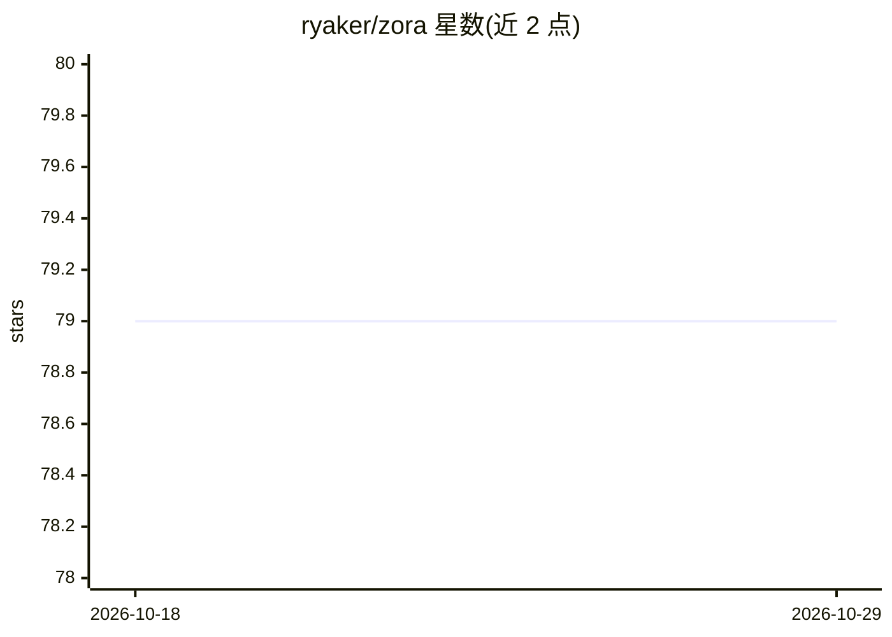

# ryaker/zora

⭐ 79 · TypeScript · MIT · 推送 2026-08-17 · [GitHub](https://github.com/ryaker/zora) · 个人维护

**本地长期运行的个人 AI agent，带策略引擎与记忆**

运行在用户本机的 AI agent 守护进程：通过自然语言执行文件读写、命令运行、任务自动化，并跨会话记忆偏好与项目信息（存储于本地纯文本文件）。安全机制包括默认零权限、每次动作前加载 policy.toml 的 PolicyEngine、技能包 AST 扫描、动作预算、SHA-256 哈希链审计日志、不可逆性评分与可选的 Signal/Telegram 人工审批。复用已有 Claude Code 或 Gemini CLI 会话认证，无需单独 API key。以 npm 包或源码安装，含后台 daemon 与 dashboard。

## 筛选速览

| 维度 | 判定 | 备注 |
|---|---|---|
| AI 角色 | `ai-native` | 本体是模型或模型工具 |
| 许可风险 | `permissive` | MIT |
| 部署形态 | `library` | 以包/库形式分发 |
| 模型依赖 | local-ok | 支持本地模型 |
| 硬件要求 | — | 无带数字的原话,不猜 |
| 安装摩擦 | `low` | 无编译、无系统依赖或容器化 |
| 成熟度 | — | 结构信号不足 |

## 能力要点

- 策略规则存于 policy.toml，每次动作前由 PolicyEngine 加载，不受上下文压缩影响
- 跨会话本地记忆（preferences.md / project-notes.md 等纯文本文件）
- 技能包安装前 AST 扫描（js-x-ray），无集中式技能市场
- 动作预算、不可逆性评分、哈希链审计日志与可选 HITL 审批

## 适用场景

- 让本机 agent 自动整理文件、分析代码、生成 changelog
- 通过 Signal/Telegram 远程下达任务并审批高风险操作
- 在受控权限策略下长期运行自动化任务

## 场景标签

`AI 助手` · 领域:对话与助手

## 证据(README 行号)

> L7: **Your personal AI agent. Local, secure, and memory-first.**
> L9: Zora runs on your computer, takes real actions (reads files, runs commands, automates tasks), and actually remembers

## 星数曲线

2026-10-18 79 → 2026-10-29 79（+0）

---
*卡片 v1 · prompt 1.4 · 生成 2026-10-24 · 置信度 high · 依据 README sha `a9aac8866514` · [字段定义](../../DATASET.md)*
