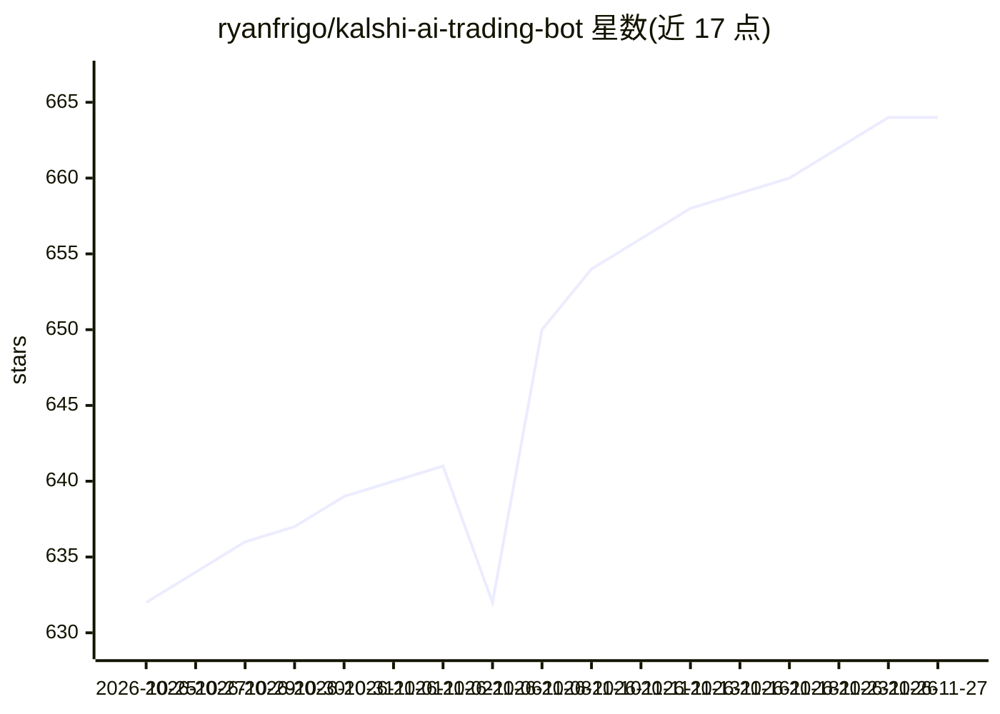

# ryanfrigo/kalshi-ai-trading-bot

⭐ 664 · Python · MIT · 推送 2026-11-09 · [GitHub](https://github.com/ryanfrigo/kalshi-ai-trading-bot) · [官网](https://kalshi-community.vercel.app) · 个人维护

**Kalshi 预测市场的 edge 测量工具包：验证是否真的跑赢盘口**

面向 Kalshi 预测市场的 agent 原生工具包，核心不是让 LLM 选交易，而是基于结算数据测量交易者是否真正战胜市场盘口。提供签名的 Kalshi API 客户端、持仓跟踪、SQLite 遥测、Streamlit 仪表盘、可插拔 LLM 客户端（OpenRouter 上任意模型）、原子化 CLI 工具、Claude skill 和 MCP server。计算 Brier 分数、log-loss、edge-vs-book 等指标，采用 forward-only 防泄漏机制，样本不足时拒绝给出 edge 结论。从结算记录自动推导 Edge Policy 门控后续交易。MIT 许可，需 Python 3.12+，通过 git clone 安装。

## 筛选速览

| 维度 | 判定 | 备注 |
|---|---|---|
| AI 角色 | `ai-enhanced` | 去掉 AI 部分产品仍成立 |
| 许可风险 | `permissive` | MIT |
| 部署形态 | `library` | 以包/库形式分发 |
| 模型依赖 | locked-api |  |
| 硬件要求 | — | 无带数字的原话,不猜 |
| 安装摩擦 | `low` | 无编译、无系统依赖或容器化 |
| 成熟度 | — | 结构信号不足 |

## 能力要点

- Brier/log-loss/edge-vs-book 测量与 gated forward-only 结论判定
- 结算→测量→重推导 Edge Policy 的自改进闭环
- 原子 CLI 工具 + MCP server + Claude skill 的 agent 驱动接口
- MCP server 默认只读，变更工具需显式 confirm

## 适用场景

- 测量自己在 Kalshi 上的真实胜率是否超过盘口隐含概率
- 让 AI agent 通过 MCP 或 CLI 工具驱动交易流程
- 从历史结算记录自动生成交易门控策略

## 场景标签

`金融量化` · 领域:学习与行业

## 证据(README 行号)

> L12: An agent-native toolkit for Kalshi whose flagship isn't "an LLM that picks trades" — it's a rigorous, settlement-gr
> L14: Under the hood: a signed Kalshi API client, market-data ingestion, position tracking, SQLite telemetry, a Streamlit

## 星数曲线

2026-10-25 632 → 2026-11-27 664（+32）

---
*卡片 v1 · prompt 1.4 · 生成 2026-11-24 · 置信度 mid · 依据 README sha `3d12bb864a70` · [字段定义](../../DATASET.md)*
