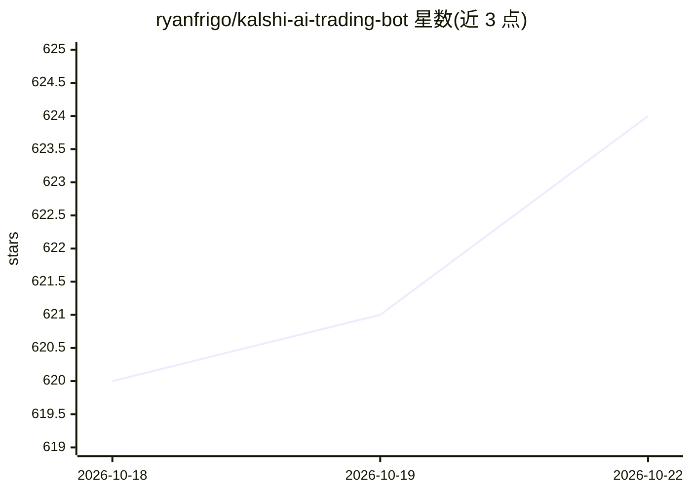

# ryanfrigo/kalshi-ai-trading-bot

⭐ 624 · Python · MIT · 推送 2026-10-13 · [GitHub](https://github.com/ryanfrigo/kalshi-ai-trading-bot) · 个人维护

**面向 Kalshi 预测市场的 AI 交易策略工具包与胜率度量框架**

Python 工具包，供开发者构建并运行 Kalshi 预测市场交易策略。核心组件包括：签名 Kalshi API 客户端、行情数据摄取、持仓跟踪、SQLite 遥测、Streamlit 仪表盘、可插拔 LLM 客户端（经 OpenRouter 接任意模型）、原子化 agent CLI（下单/平仓/结算/校准）、Claude 技能与 MCP 服务器。关键机制：cli edge 用 Kalshi 官方结算数据计算 Brier 分数、log-loss 与相对盘口的边际，仅统计前向结算交易且少于 10 笔时拒绝判定；Edge Policy 从已结算记录自动派生交易门控。限制：无回测语料库（cli backtest 说明原因），示例策略在某些市场亏损，需自备 API key，非开箱即用。

## 筛选速览

| 维度 | 判定 | 备注 |
|---|---|---|
| AI 角色 | `ai-ecosystem` | LLM/agent 周边工具 |
| 许可风险 | `permissive` | MIT |
| 部署形态 | `library` | 以包/库形式分发 |
| 模型依赖 | — | README 未给出锁定关系 |
| 硬件要求 | — | 无带数字的原话,不猜 |
| 安装摩擦 | `low` | 无编译、无系统依赖或容器化 |
| 成熟度 | — | 结构信号不足 |

## 能力要点

- Brier/log-loss/edge-vs-book 前向结算评分，样本不足时拒绝判定边际
- Edge Policy 自已结算记录派生交易门控（封锁亏损类别、削减过高置信估计）
- 原子化 CLI 工具集（trade/close/settle/edge/policy/improve），交易默认 dry-run 并经风险治理器
- MCP 服务器暴露治理器门控工具，可从 Claude Desktop/Claude Code 驱动，key 不离开本机

## 适用场景

- 度量自己的 Kalshi 交易记录是否真有胜率边际
- 构建带风险治理与结算校准的 agent 交易策略
- 通过 MCP 客户端驱动交易工具链并留存决策日志

## 场景标签

 · 领域:金融/量化交易

## 证据(README 行号)

> L14: Under the hood: a signed Kalshi API client, market-data ingestion, position tracking, SQLite telemetry, a Streamlit
> L120: The toolkit is built to be driven by an agent (Claude, or anything else) through small, composable tools — each do
> L143: **MCP server** (`src/mcp_server.py`) — a first-mover Model Context Protocol server. No official Kalshi MCP exists;

## 星数曲线

2026-10-18 620 → 2026-10-22 624（+4）

---
*卡片 v1 · prompt 1.4 · 生成 2026-10-21 · 置信度 high · 依据 README sha `ed3be0d89d63` · [字段定义](../../DATASET.md)*
